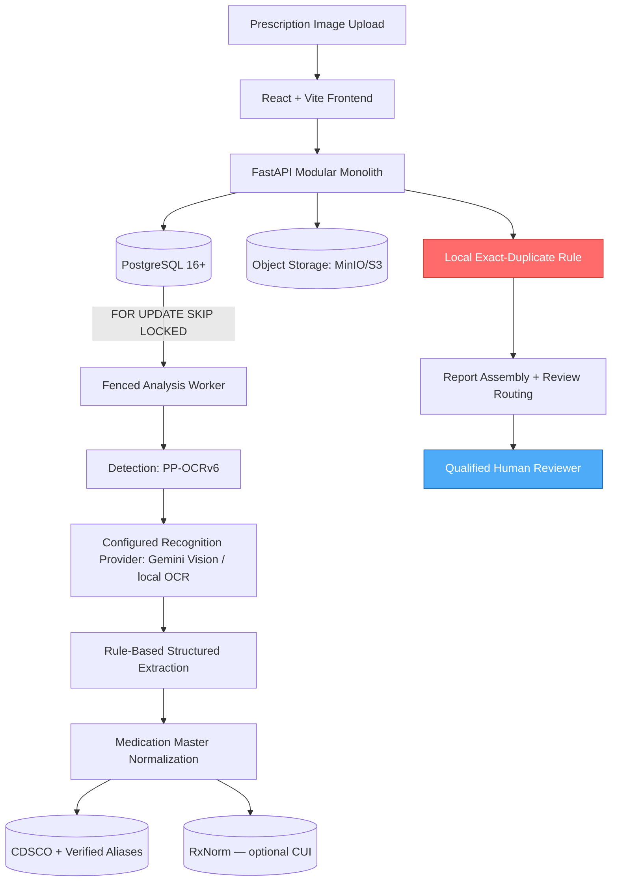
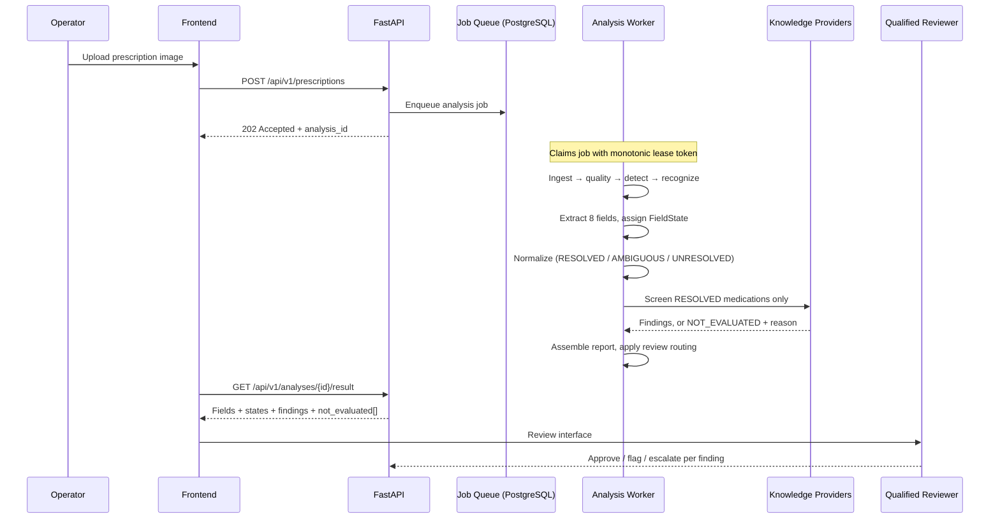

# Prescripto AI 2.0

### Prescription Document Intelligence & Medication-Safety Decision Support

[](https://www.python.org/)
[](https://fastapi.tiangolo.com/)
[](https://react.dev/)
[](https://pytorch.org/)
[](https://www.postgresql.org/)


Prescripto AI 2.0 extracts structured medication data from prescription images, resolves each drug to a canonical identity, screens the result against licensed safety sources, and presents a provenance-backed report to a qualified human reviewer.

It does not diagnose, prescribe, or claim comprehensive interaction coverage. **No finding is actionable until a qualified reviewer signs off.** This is an academic research prototype, not a cleared medical device.

---

## Table of Contents

- [Prescripto AI 2.0](#prescripto-ai-20)
    - [Prescription Document Intelligence \& Medication-Safety Decision Support](#prescription-document-intelligence--medication-safety-decision-support)
  - [Table of Contents](#table-of-contents)
  - [Problem](#problem)
  - [Approach](#approach)
  - [Project Status](#project-status)
  - [System Architecture](#system-architecture)
  - [Pipeline Flow](#pipeline-flow)
  - [Uncertainty Model](#uncertainty-model)
  - [Safety Boundary](#safety-boundary)
  - [What V1 Does and Doesn't Cover](#what-v1-does-and-doesnt-cover)
  - [Tech Stack](#tech-stack)
  - [Knowledge Sources](#knowledge-sources)
  - [Documentation](#documentation)
  - [Local Setup](#local-setup)
  - [Project Structure](#project-structure)
  - [Privacy \& Safety Design](#privacy--safety-design)
  - [Team](#team)
  - [References](#references)
  - [License](#license)

---

## Problem

Illegible handwriting on prescriptions is a documented source of medication error — misread dosages, duplicate medications, and missed interactions often go undetected until the pharmacy counter. Existing digitization tools stop at OCR: they convert handwriting to text and do nothing to verify the result is clinically sound.

The harder problem is that a verification system built carelessly is worse than none. A tool that reports "no interactions found" when it simply lacks the data, or reports a drug name it half-guessed, manufactures false confidence in exactly the situation where confidence is most dangerous.

## Approach

The current application includes a FastAPI backend and React/Vite frontend. The worker supports local OCR and a Gemini vision provider; Gemini extraction is unverified and always requires human review. No recognition accuracy claim is made without evaluation against manually verified prescription images.

Prescripto treats this as a pipeline problem with one governing rule:

> **Upstream uncertainty must never silently become downstream clinical certainty.**

If OCR is unsure, extraction inherits that doubt. If extraction is unsure, normalization does. If a knowledge source has no coverage, the report says so rather than staying quiet. Nothing rounds up to confident.

Concretely:

1. **Extraction** — line-level detection, then handwriting recognition on cropped lines. Every field gets one of four states: `CLEAR`, `AMBIGUOUS`, `UNREADABLE`, `NOT_PRESENT`.
2. **Normalization** — drug names resolve against an internal Medication Master (CDSCO-sourced + verified aliases, RxNorm CUI where one exists). No confident match means `UNRESOLVED` and a trip to human review — never a best guess.
3. **Screening** — one local rule may flag an exact repeated canonical product ID on the same document as `POTENTIAL`. DDI, dosage, allergy, adverse-event, and external evidence checks are out of scope in V1.
4. **Review** — a qualified reviewer sees the image, the fields with their states, the findings with their sources, and an explicit list of what was *not* checked.

Only two of eight pipeline stages use a learned model. Dosage parsing and safety screening are deterministic on purpose: a regex that mis-parses `500mg` is debuggable in minutes and fails identically every time; a model that does the same fails unpredictably and needs labeled data just to diagnose.

## Project Status

Research prototype. The backend, worker, and frontend exist; model performance, deployment readiness, and privacy approval still require validation.

| Phase | Status |
|---|---|
| Product/architecture decision baseline | ✅ Updated 2026-10-02 |
| OCR pipeline and evaluation protocol | ✅ Specified; not empirically validated |
| Backend API + worker (FastAPI, PostgreSQL, MinIO, job queue, fencing) | ✅ Implemented and tested |
| ML service (FastAPI, PP-OCRv6 adapter, `POST /v1/ocr/recognize`) | ✅ Implemented; PaddleOCR dependency optional |
| Machine-readable OpenAPI schema (`OPENAPI.yaml`) | ✅ Present (hand-maintained; not yet auto-generated from code) |
| Frontend (React + Vite) | ✅ Implemented in `web/`; build validation is required before deployment |
| OCR model selection + Tier B evaluation | 🔲 Blocked — no labeled dataset yet |
| Calibration startup gate (refuse to start without calibration snapshot) | 🔲 Schema exists; startup enforcement not wired |
| Legal/licensing review for CDSCO data collection | 🔲 Outstanding |
| `mypy --strict` + ruff + contract CI gates | 🔲 CI runs pytest + pyflakes only |

The backend API and worker are runnable today with Docker Compose. See [Current Status](#current-status) for how to start them.

---

## System Architecture



Compose starts `api`, `worker`, `postgres`, `minio`, and `deletion_worker`. The `ml-service` image exists but is disabled (compose profile `ml-service`); do not set `ML_RUNTIME_MODE=remote`. No Redis, Kafka, Kubernetes, vector database — each is deferred behind a measured trigger documented in the architecture, and none has fired.

## Pipeline Flow



Analysis is asynchronous throughout. Upload returns before processing starts; the client polls. Stage commits are guarded by lease validation and a generation fencing token, so a slow or crashed worker cannot duplicate findings when another worker picks the job up.

---

## Uncertainty Model

Four field states propagate through every stage:

| State | Meaning | Downstream |
|---|---|---|
| `CLEAR` | High calibrated confidence | Proceeds normally |
| `AMBIGUOUS` | Uncertain or conflicting | Inherited downstream; finding capped at `POTENTIAL` |
| `UNREADABLE` | Illegible | Structurally excluded — passing it downstream raises an exception |
| `NOT_PRESENT` | Absent from the document | Remains absent; never converted to zero, a default, or `AMBIGUOUS` |

Model confidence scores are **calibrated per model version** before use. Raw beam-search scores and CTC probabilities aren't comparable and aren't probabilities; thresholding them directly would make review routing arbitrary — which quietly breaks the human-in-the-loop guarantee the whole system rests on. A model without a calibration snapshot cannot load; the worker refuses to start.

There is deliberately **no single "overall confidence" score.** Five clear fields and one ambiguous field is not "96% confident" — it's five of one thing and one of another, reported as such.

## Safety Boundary

V1 has one local deterministic check: the same resolved, verified canonical product ID repeated within a prescription may be flagged as a `POTENTIAL` duplicate for reviewer attention. This is not a patient medication-history check and does not infer that the prescriptions are clinically unsafe.

Checks that cannot run are represented in a separate `not_evaluated[]` coverage list with a reason. They are not findings and can never be rendered as a negative result.

> **The distinction the system is built around:** `NO_KNOWN_INTERACTION_IN_DATABASE` ≠ `NO_INTERACTION_EXISTS`, and `NOT_EVALUATED` ≠ `SAFE`. These are separate values in the data model, the API response, and the UI. Collapsing them is the easiest way to build something actively dangerous.

## What V1 Does and Doesn't Cover

Stated plainly, because a safety tool that overstates its coverage is the failure mode worth avoiding most.

| V1 supports | Out of scope (and why) |
|---|---|
| Medication identity resolution | **Drug–drug interaction checking** — no legally obtainable Indian DDI dataset identified |
| Duplicate medication detection | **Dosage-range checking** — no licensed dosage reference integrated |
| Structured extraction of 8 fields with per-field confidence | **Allergy / contraindication checks** — no patient allergy record intake in V1 |
| Coverage-honest report and review routing | **All external evidence lookups** — no V1 third-party medication queries |
| Ambiguity detection and review routing | **Multi-language reports** — English only |
| Coverage-honest reporting | **Automated model deployment** — needs measured regression gates first |

**Not supported, by design:** diagnosis, treatment recommendation, autonomous prescribing, comprehensive clinical validation.

Gemini image recognition is selected with `RECOGNITION_PROVIDER=gemini`. The separate, optional summary layer is controlled by `LLM_ENABLED`; source transcription remains unverified and distinct from generated commentary.

---

## Tech Stack

| Layer | Technology | Rationale |
|---|---|---|
| Frontend | React, Tailwind, Vite | TypeScript API client and reviewer UI |
| API | Python 3.11, FastAPI | OpenAPI generated from Pydantic; spec is canonical |
| Database | PostgreSQL 16+ | Relational integrity, CHECK constraints as safety invariants, `FOR UPDATE SKIP LOCKED` job queue, JSONB, full-text search |
| Object storage | MinIO (dev) → S3 (prod) | boto3 only; swap is config |
| Job queue | PostgreSQL + lease tokens | No second datastore to keep in sync |
| Detection | PP-OCRv6 candidate | Evaluated on prescription-specific region and line-grouping metrics |
| Recognition | Gemini Vision or local OCR | No accuracy claim until manually verified image evaluation |
| Extraction | Rule-based | Auditable and deterministic where errors are clinical |
| Deployment | Docker Compose | Same config for dev and deploy |

## Knowledge Sources

Every source's license is verified at its primary source before use. Reputation and "it's on HuggingFace" are not verification.

| Source | License | V1 role |
|---|---|---|
| **RxNorm** | Public terminology | Not queried at runtime in V1; US-centric and not the identity authority |
| **openFDA** | Public US data | Not queried at runtime; labels/FAERS do not establish Indian-market coverage or adverse-event causality |
| **SIDER 4.1** | CC BY-NC-SA 4.0 | Not used in V1; licensing and mapping constraints remain |
| **CDSCO** | Indian regulatory data | A small hand-crafted formulation list (10 sample entries) labelled `CDSCO_REGULATORY` is seeded in `scripts/seed_medications.py` for development. **Official CDSCO data has not been ingested; written legal/reuse clearance is outstanding.** |
| **DrugBank** | Academic tier is non-clinical use only | ❌ Not used at runtime — the free tier doesn't clearly cover a clinical-decision-support use case |
| **MIMIC-IV** | PhysioNet credentialed | ❌ Not a dependency — contains no prescription images, wrong data type for this problem |

Evaluation requires a purpose-built, legally approved **Tier B** benchmark with independent annotation and a writer/source-grouped lockbox. The 200–500 count is a collection target, not proof of statistical adequacy. See [`EVALUATION-PLAN.md`](docs/EVALUATION-PLAN.md).

---

## Documentation

19 specification documents under [`docs/`](docs/); this is not a complete implementation package.

| Start here | Covers |
|---|---|
| [`PROJECT-SPEC.md`](docs/PROJECT-SPEC.md) | **Canonical** terminology, enums, conflict register |
| [`PRD_V1.md`](docs/PRD_V1.md) | Product requirements; alignment with the decision baseline is in progress |
| [`Architecture.md`](docs/Architecture.md) | Components, DDL, ADRs, execution model |
| [`ML-PIPELINES.md`](docs/ML-PIPELINES.md) and [`EVALUATION-PLAN.md`](docs/EVALUATION-PLAN.md) | OCR-to-report contract and evaluation gates |
| [`IMPLEMENTATION-PLAN.md`](docs/IMPLEMENTATION-PLAN.md) | Vertical slices and build order |
| [`DEPLOYMENT.md`](docs/DEPLOYMENT.md) | Backend secrets, Gemini free-tier limits, and deployment configuration |

The machine-readable OpenAPI document, threat model, and test strategy are not present yet and remain implementation gates; no docs-only file substitutes for generated API schemas or verified tests.

---

## Current Status

Implemented surfaces:

```
docker compose up          # starts api, worker, postgres, minio (ml-service disabled)
cd backend
python -m pip install -e ".[dev]"
python -m pytest -q
cd ..\web
npm ci
npm run build
```

The API is reachable at `http://localhost:8000` and the frontend is in `web/`. Recognition defaults to Gemini (`GEMINI_MODEL=gemini-3.5-flash`, fallback `gemini-3.1-flash-lite`) with a backend-only `GEMINI_API_KEY`. Local RapidOCR runs only if Gemini returns quota, auth, or timeout. The remote `ml-service` path is disabled. Upload and result retrieval are asynchronous; extracted text and any medication candidates remain unverified and require human review.

**Authentication is not production-ready.** Patient login currently uses a fixed test OTP and sends no SMS; rate limiting for authentication and uploads is not implemented. Do not deploy this flow for real patient accounts or process real patient data until production authentication, authorization, privacy, and rate-limiting controls are implemented and reviewed.

The Gemini free tier has account-, model-, region-, and time-dependent quotas and may change without notice. Do not send identifiable prescription or patient data to Gemini's free tier unless the organization has approved the applicable privacy, legal, and data-processing terms. Quota, auth, or timeout failures fall back to local RapidOCR; they are not retried against a paid Gemini provider.

The optional `LLM_ENABLED` summary layer is disabled by default. When enabled it also uses Gemini; it does not authoritatively replace the source extraction fields.

### Planned (not implemented)

The following items are specified in the architecture documents but are not yet wired in code:

| Item | Where specified | Gap |
|---|---|---|
| Frontend deployment hosting | `web/` | Build and configure the deployed API base URL |
| Calibration startup gate | `DEPLOYMENT.md §52-61`, `ML-ARCHITECTURE.md §37` | Schema exists; startup check not wired |
| Rate limiting on auth + upload | `SECURITY.md §65-67` | Not implemented |
| `mypy --strict` + ruff + contract CI gates | `CI-CD.md` | CI runs pytest + pyflakes only |
| `deletion_worker` compose service | `DEPLOYMENT.md` | Code exists; not added to `docker-compose.yml` |

## Local Setup

```bash
# 1. Copy backend/.env.example to backend/.env (PowerShell)
Copy-Item backend\.env.example backend\.env

# 2. Install backend dependencies and generate JWT keys
python -m pip install -e "backend[dev]"
python backend\scripts\generate_keys.py

# 3. Set GEMINI_API_KEY in backend\.env. Host DATABASE_URL already uses localhost:5435.
#    Never put the key in web/.env or any VITE_ variable.

# 4. Start backend services
docker compose up -d

# 5. Run migrations
docker compose exec api alembic upgrade head

# 6. Seed sample medications
docker compose exec api python scripts/seed_medications.py

# 7. Create an operator user
docker compose exec api python scripts/create_user.py
```

The API docs are served at `http://localhost:8000/docs`.

Run the frontend separately with `cd web`, `npm ci`, then `npm run dev` (Vite on port 5173; CORS allows that origin). For a separately hosted frontend, set `VITE_API_BASE_URL` to the backend API root (the default is `/api/v1`); never place `GEMINI_API_KEY` in any `VITE_` variable. Deploy with `GEMINI_API_KEY`, `GEMINI_MODEL=gemini-3.5-flash`, and `GEMINI_FALLBACK_MODEL=gemini-3.1-flash-lite` on the API and worker only.

## Project Structure

```
backed/
  prescripto/
    api/           FastAPI routes and schemas
    worker/        Job queue, heartbeat, coordinator, pipeline driver
    pipeline/      Stage handlers (engine.py)
    domain/        Pure-Python domain models (medication, safety, review, uncertainty)
    application/   Use cases and application services
    db/            ORM models, Alembic migrations
    ml/            Backend ML interface (MockModelRuntime, RemoteMLClient)
    knowledge/     OpenFDA + local safety providers
    storage/       MinIO/S3 client
    audit/         PHI-safe structured logging
    config/        Pydantic settings
  scripts/         Seeds, key generation, user creation
  tests/           Unit + integration (pytest, SQLite + PostgreSQL)
ml/
  app/             Standalone ML FastAPI service (PP-OCRv6, extraction)
docs/              19 specification documents
research/          CER/WER evaluation scripts (not production)
OPENAPI.yaml       Hand-maintained API schema (full endpoint coverage)
docker-compose.yml Starts api + worker + postgres + minio + ml-service
```

The canonical architecture description is in [`Architecture.md`](docs/Architecture.md).

---

## Privacy & Safety Design

India is the intended research context. This specification does not establish DPDPA compliance or a lawful basis to collect/process personal data. Obtain current legal and ethics review before collecting real prescriptions; do not use real patient data in development or demos.

- **Verifiable deletion, not just a deleted row.** Deletion spans PostgreSQL, object storage, and derived artifacts, then writes an immutable manifest to a separately-permissioned retention vault. Without that manifest, a backup restore resurrects deleted data — so manifest re-application is a mandatory step in the restore procedure, not a note in a runbook.
- **Global knowledge preserved.** Deletion purges prescription-scoped records only. The canonical Medication Master and knowledge snapshots are never deleted — one user's erasure must not degrade the system for everyone.
- **No PHI in logs**, enforced by a whitelist processor that drops any unlisted field and increments a metric. A blacklist would need to predict every field a future developer might add.
- **Application-mediated storage.** No public bucket. Presigned GET URLs with a 60-second TTL, never logged or stored.
- **External processing is explicit.** With `RECOGNITION_PROVIDER=gemini` (default), prescription image bytes are sent from the backend to Google Gemini (`gemini-3.5-flash`, fallback `gemini-3.6-flash`) for vision extraction. Do not use identifiable data with the free tier without privacy/legal approval. The API key remains backend-only. Local RapidOCR is used only after Gemini quota, auth, or timeout — not a paid-provider fallback. The remote ml-service is disabled.
- **Source text and generated summaries are separate.** Image transcription is shown as unverified source extraction; any plain-language summary is labeled generated content and cannot replace clinician or pharmacist review.
- **Human-in-the-loop.** No auto-approve path exists. No finding is actionable without a qualified reviewer.
- **Full reproducibility.** Every analysis pins its pipeline version, model version, checkpoint hash, calibration snapshot, and per-finding knowledge snapshot. `"latest"` is banned in production code paths and checked in CI.

Security controls are proposed in [`SECURITY.md`](docs/SECURITY.md); a threat model remains a pre-real-data gate. **Nothing here has been penetration-tested or independently audited** — the system is described as security-conscious, not secure.

---

## Team

| Name | Role |
|---|---|
| Dipak | System Architect |
| Bhushan | Backend Development |
| Aakanksha | Frontend Development |
| Prachi | AI/ML Engineer |

Third-year AI/ML project, R.C. Patel Institute of Technology, Shirpur.

## References

Lee, J., Yoon, W., Kim, S., Kim, D., Kim, S., So, C.H., Kang, J. (2020). *BioBERT: A Pre-trained Biomedical Language Representation Model for Biomedical Text Mining.* Bioinformatics, 36(4), 1234–1240. https://doi.org/10.1093/bioinformatics/btz682

Full reference list with verification status: [`docs/REFERENCES.md`](docs/REFERENCES.md).

## License

Not yet decided. To be added before any public release.
