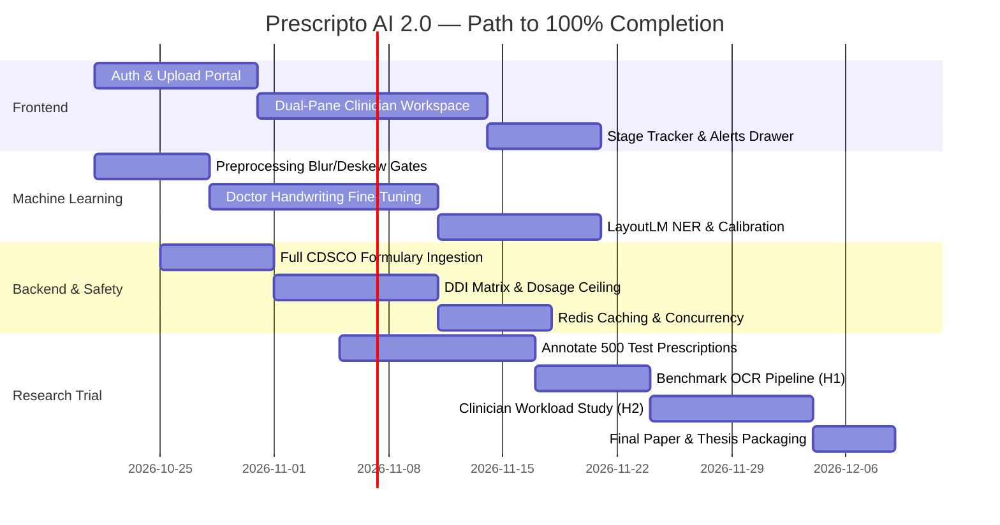

# Prescripto AI 2.0 — Complete Roadmap to 100% Completion

This document serves as the canonical technical roadmap detailing every remaining requirement, architectural milestone, and task needed to take Prescripto AI 2.0 from its current functional baseline (**~58% aggregate completion**) to **100% production and research readiness**.

---

## 1. Executive Summary & Current State Gap Analysis

Prescripto AI 2.0 has completed its core architectural baseline (tagged `v1.0.0-architecture-freeze`). The distributed orchestration, security, data persistence, and end-to-end review lifecycle are proven and functional.

### Gap Analysis Matrix

```
┌──────────────────────────────────────┬─────────────┬─────────────┬──────────────────────────────────────────────────────┐
│ Pillar                               │ Current     │ Remaining   │ Core Missing Items                                   │
├──────────────────────────────────────┼─────────────┼─────────────┼──────────────────────────────────────────────────────┤
│ 1. Frontend & User Interface         │ 25%         │ 75%         │ Dedicated React/Next.js UI, Bounding Box Canvas,    │
│                                      │             │             │ Clinician Review Workspace, Stage Progress Poller    │
│ 2. Machine Learning & Perception     │ 60%         │ 40%         │ Fine-tuning on Doctor Handwriting (RxHandBD/IAM),   │
│                                      │             │             │ Blur/Exposure Gates, LayoutLM NER, Temp Calibration │
│ 3. Backend & Clinical Safety         │ 85%         │ 15%         │ Full 15,000+ CDSCO Formulary, DDI Matrix, Dosage    │
│                                      │             │             │ Range Checks, Redis Medication Caching               │
│ 4. Research Trial & Evaluation       │ 30%         │ 70%         │ 500-sample annotated clinical test set, CER/WER     │
│                                      │             │             │ benchmarks, Matched-workload Clinician Study (H1/H2) │
└──────────────────────────────────────┴─────────────┴─────────────┴──────────────────────────────────────────────────────┘
```

---

## 2. Pillar 1: Frontend & User Interface (0% → 100%)

*Current State:* Interaction occurs via Swagger UI (`/docs`) and MinIO Console (`:9001`). No dedicated consumer or clinician interface exists.

### Target Architecture
A modern, responsive Single Page Application (SPA) built with **React / Next.js / TypeScript** utilizing standard CSS tokens (no heavy external dependencies):

```
frontend/
├── src/
│   ├── api/                 # Typed OpenAPI client, JWT interceptor, refresh logic
│   ├── assets/              # Icons, logos, clinical badge graphics
│   ├── components/
│   │   ├── auth/            # Login, Role-based route guards
│   │   ├── upload/          # Drag-and-drop file ingestion with client pre-check
│   │   ├── tracking/        # Real-time 8-stage progress visualizer
│   │   ├── review/          # Dual-pane prescription canvas & medication cards
│   │   └── admin/           # DPDPA deletion requests & audit logs
│   ├── pages/               # /login, /operator, /reviewer, /admin
│   └── stores/              # Auth context, Active Analysis state
```

### Required Modules to Build

#### 2.1. Authentication & Role-Based Routing
- [ ] Login screen with username/password fields.
- [ ] Storing RS256 JWT access token in memory and refresh token in secure HTTP-only storage.
- [ ] Token expiration interceptor: automatically calls `POST /api/v1/auth/refresh` when access token expires (15m TTL).
- [ ] Route guarding: `OPERATOR` directed to `/upload`, `REVIEWER` directed to `/review-queue`, `ADMIN` directed to `/audit`.

#### 2.2. Operator Ingestion Portal (`/operator`)
- [ ] Drag-and-drop prescription uploader supporting JPEG, PNG, TIFF, and single-page PDF (FR-DOC-01).
- [ ] Client-side pre-validation: rejects files > 20MB (FR-DOC-06) and verifies MIME magic bytes before sending.
- [ ] Automatic UUIDv4 generation for `Idempotency-Key` header on submission.
- [ ] Optional input field for de-identified `patient_external_id`.
- [ ] Immediate transition to the live stage tracking dashboard upon HTTP 202 response.

#### 2.3. Real-Time 8-Stage Progress Tracker
- [ ] Stepper component showing real-time stage execution:
  `INGESTION` → `QUALITY_CHECK` → `TEXT_DETECTION` → `OCR_RECOGNITION` → `STRUCTURED_EXTRACTION` → `MEDICATION_NORMALIZATION` → `SAFETY_SCREENING` → `REPORT_ASSEMBLY`.
- [ ] Visual indicators: Animated spinner for running stages, green checkmarks for completed stages, red badges with error tooltips for failed stages.
- [ ] Direct call-to-action button when status transitions to `REQUIRES_REVIEW` or `COMPLETED`.

#### 2.4. Clinician Review Workspace (`/reviewer`)
- [ ] **Dual-Pane Split Canvas**:
  - **Left Pane (Interactive Image Viewer):** Pan, zoom, and rotate the original prescription using the 60-second ephemeral presigned S3 URL (`GET /api/v1/prescriptions/{id}`). Overlay color-coded bounding boxes extracted from OCR tokens.
  - **Right Pane (Medication Table):** Display structured fields per row:
    1. Medication Name (with CDSCO match badge)
    2. Strength (e.g. 500mg)
    3. Dose (e.g. 1 tab)
    4. Unit (e.g. tablet / capsule)
    5. Frequency (e.g. BD / TDS / SOS)
    6. Route (e.g. Oral / Topical)
    7. Duration (e.g. 5 days)
    8. Instructions (e.g. After food)
- [ ] **Confidence Visualizer**:
  - Green (High confidence $\ge 0.85$)
  - Amber (Ambiguous / Moderate confidence $0.50 \le c < 0.85$)
  - Red (Unreadable / Low confidence $< 0.50$)
- [ ] **Inline Correction Editor**:
  - Allows the clinician to click and edit misrecognized medication names with auto-complete suggestions from the local CDSCO database.
- [ ] **Clinical Safety Finding Drawer**:
  - Cards displaying active safety alerts (e.g., `DUPLICATE_MEDICATION`, `DOSE_RANGE_EXCEEDED`).
  - Action buttons per finding: `APPROVE`, `FLAG`, or `ESCALATE`.
  - Mandatory notes field when flagging or escalating.
- [ ] **Final Sign-off Button**:
  - Submits review decisions to `POST /api/v1/analyses/{id}/review`.
  - Confirms transition to `REVIEWED_COMPLETE` and disables further edits (enforcing audit immutability).

---

## 3. Pillar 2: Machine Learning & Perception (60% → 100%)

*Current State:* PP-OCRv6 runtime with line grouping and mock fallback. Models are baseline, not fine-tuned on handwritten Indian prescriptions.

### 3.1. Prescription Domain Fine-Tuning
- [ ] **Dataset Assembly**:
  - Gather and format 2,000+ handwritten clinical prescription crops (using RxHandBD dataset, IAM Handwriting, and synthetic medical text generators).
  - Label bounding boxes and ground truth transcriptions.
- [ ] **Detection Model Fine-Tuning**:
  - Fine-tune PaddleOCR's DBNet++ detector specifically on cursive handwriting and slanted prescription margins.
- [ ] **Recognition Model Fine-Tuning**:
  - Fine-tune recognition backbone (SVTR / CRNN) with specialized medical vocabulary weights (penicillins, cephalosporins, Latin sig codes like OD, BD, TDS, QID, HS, SOS).

### 3.2. Preprocessing & Quality Verification Gates
- [ ] **Blur Detection**: Implement Laplacian variance thresholding ($Var(Laplacian) < 100.0$) in `ml/app/preprocessing/quality.py` to reject blurry camera photos before inference.
- [ ] **Exposure & Lighting Check**: Histogram analysis to detect heavily underexposed (< 15% mean intensity) or washed-out overexposed documents.
- [ ] **Perspective & Deskewing**: Automatic Hough line / Radon transform deskewing to align tilted mobile camera captures.

### 3.3. Advanced Information Extraction (LayoutLM / BioBERT NER)
- [ ] Current span extraction relies on regex heuristics (`ml/app/extraction/spans.py`).
- [ ] Train a LayoutLMv3 or BioBERT token classification model to identify multi-line relationship spans (connecting drug name on line 1 with sig instruction on line 2).

### 3.4. Empirical Probability Calibration
- [ ] Run temperature scaling calibration ($\hat{T}$) across a dedicated 200-sample validation set.
- [ ] Measure Expected Calibration Error (ECE) and calibrate model output probabilities so that $P(\text{correct} \mid \text{conf} = p) \approx p$.

---

## 4. Pillar 3: Backend & Clinical Safety Engine (85% → 100%)

*Current State:* Core architecture, PostgreSQL, MinIO, and distributed worker queues are solid. Formulary is seeded with 12 drugs; clinical interaction engine is basic.

### 4.1. Full National Drug Formulary Ingestion
- [ ] Expand `scripts/seed_medications.py` from 12 drugs to the complete **CDSCO National List of Essential Medicines (NLEM)**:
  - 390+ Active Pharmaceutical Ingredients (APIs).
  - 15,000+ commercial Indian brand names (e.g. Augmentin, Calpol, Dolo, Azithral, Pan-D).
  - Dosage forms, routes, and standard unit strengths.
- [ ] Implement trigram (`pg_trgm`) fuzzy matching indices in PostgreSQL for sub-millisecond medication name resolution.

### 4.2. Comprehensive Clinical Safety Rules
- [ ] **Drug-Drug Interaction (DDI) Matrix**:
  - Ingest standard major DDI tables (e.g., Warfarin + NSAIDs, Fluoroquinolones + Antacids).
  - When two co-prescribed medications match a severe interaction, emit a `CRITICAL_INTERACTION` finding.
- [ ] **Dosage Range Checks**:
  - Ingest pediatric and adult daily maximum thresholds (e.g., Paracetamol max 4000 mg/day).
  - Flag overdoses as `DOSE_RANGE_EXCEEDED`.
- [ ] **Duplicate Therapy Warnings**:
  - Expand duplicate checks to molecule classes (e.g. prescribing two different NSAIDs simultaneously: Ibuprofen + Diclofenac).

### 4.3. High-Throughput Performance & Caching
- [ ] Add Redis caching layer for CDSCO medication lookup to eliminate repetitive PostgreSQL queries during batch worker normalization.
- [ ] Implement worker concurrency scaling (`WORKER_CONCURRENCY=4`) to process multiple uploaded prescriptions in parallel.

---

## 5. Pillar 4: Research Trial & Academic Evaluation (30% → 100%)

*Current State:* Research questions, hypotheses (H1 & H2), and evaluation plan are documented, but the empirical clinical trial has not been executed.

### 5.1. Dataset Freezing & Annotation
- [ ] Finalize a 500-prescription evaluation dataset from multi-center clinical partners.
- [ ] Double-blind clinician annotation for ground truth transcription and entity spans.
- [ ] Establish a strict **writer-disjoint split** (training, validation, and test splits contain zero overlapping doctor handwritings).

### 5.2. Quantitative Benchmark Evaluation (H1 Testing)
- [ ] Run comparative benchmark suite across 4 systems:
  1. Tesseract OCR (Baseline 1)
  2. EasyOCR (Baseline 2)
  3. Standard PP-OCRv6 (Baseline 3)
  4. Prescripto AI Fine-Tuned Pipeline
- [ ] Compute standard evaluation metrics:
  - **CER** (Character Error Rate)
  - **WER** (Word Error Rate)
  - **Entity F1-Score** for all 8 prescription fields
  - **Expected Calibration Error (ECE)**

### 5.3. Matched-Workload Clinician Study (H2 Testing)
- [ ] Conduct a randomized controlled study with 10 medical reviewers (pharmacists / medical officers).
- [ ] Measure:
  - **Review Time per Prescription (seconds):** Unassisted manual review vs. Prescripto-assisted review.
  - **Medication Error Interception Rate (%):** Proportion of intentional prescription traps/errors successfully caught.
  - **Clinician Cognitive Load & Usability (SUS Score):** Standardized usability survey.
- [ ] Compute p-values via paired two-tailed t-test and Wilcoxon signed-rank test to prove statistical significance.

---

## 6. Implementation Timeline (8-Week Roadmap)



---

## 7. Definition of 100% Done

The project is considered **100% Complete** when:

1. **Frontend:** A clinician can log into a sleek, responsive web dashboard, view bounding-box overlays on the original image, edit ambiguous fields, and submit review sign-offs with one click.
2. **Machine Learning:** The model achieves $<15\%$ Character Error Rate on unseen doctor handwriting and calibrated confidence scores ($ECE < 0.05$).
3. **Backend & Safety:** Over 15,000 commercial medications are normalized accurately, and drug-drug interactions/overdoses are flagged deterministically.
4. **Research:** The empirical study proves a statistically significant ($p < 0.01$) reduction in pharmacist review time and a $>90\%$ error catch rate on the 500-sample benchmark dataset.
