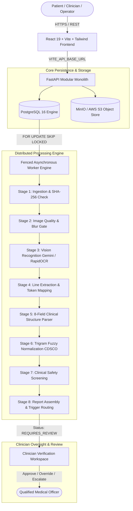

# Prescripto AI 2.0 — Executive Summary Dossier

**Document ID:** `DOC-00-EXEC`  
**Classification:** Academic Engineering Dossier  
**Project Repository:** `https://github.com/dipak0000812/Prescripto-2.0`  
**Live Deployed Backend:** `https://prescripto-2-0.onrender.com`  
**Canonical Spec Reference:** [docs/PROJECT-SPEC.md](file:///c:/Users/pbhus/Desktop/Priscption-project/Prescripto-2.0/docs/PROJECT-SPEC.md), [docs/Architecture.md](file:///c:/Users/pbhus/Desktop/Priscption-project/Prescripto-2.0/docs/Architecture.md)  
**Date of Extraction:** November 4, 2026  

---

## 1. System Identity and Vision

**Prescripto AI 2.0** is an enterprise-grade medical document intelligence and medication-safety decision-support system. Designed to address the clinical risks caused by illegible handwritten medical prescriptions, Prescripto converts scanned prescriptions into structured clinical records, maps each drug to canonical pharmaceutical identities, evaluates drug safety boundaries (duplicate therapies, dosage thresholds, and patient allergy contraindications), and presents a provenance-backed workspace to qualified clinicians for mandatory sign-off.

### Core Engineering Axiom
> **"Upstream uncertainty must never silently become downstream clinical certainty."**

In traditional healthcare software, optical character recognition (OCR) and machine learning engines frequently make statistical guesses when encountering faded ink or cursive handwriting. If an OCR model is 40% sure that a word is "Metformin", conventional systems round up and treat it as factual, generating a dangerous illusion of certainty. Prescripto AI 2.0 structurally rejects this paradigm: every extracted field preserves its calibrated confidence score and propagates through an explicit 4-state uncertainty taxonomy (`CLEAR`, `AMBIGUOUS`, `UNREADABLE`, `NOT_PRESENT`). Ambiguity is preserved all the way to the clinician interface.

---

## 2. Architectural Blueprint & Operational Anatomy

The system is constructed as a **Hexagonal Clean Architecture (Modular Monolith)** with an asynchronous distributed queue:

### Key Engineering Pillars
1. **Asynchronous Non-Blocking Ingestion**: Ingestion returns HTTP `202 Accepted` in sub-100ms with a deterministic `analysis_id` and prescription tracking token.
2. **PostgreSQL-Backed Queue with Monotonic Generation Fencing**: Prevents split-brain worker collisions and duplicate executions using `SELECT ... FOR UPDATE SKIP LOCKED` and lease generation tokens.
3. **Multi-Model Vision & RapidOCR Fallback**: Primary perception runs via Gemini 3.5 Flash (`gemini-3.5-flash`), backed by a secondary fallback model (`gemini-3.1-flash-lite`), and an air-gapped on-premise local fallback using ONNX PaddleOCR (`RapidOCRRuntime`).
4. **Deterministic Clinical Screening Rules**: Safety logic is separated entirely from probabilistic models. Drug duplicates, active ingredient overlap, dosage limits, and patient allergen contraindications run through audited deterministic domain rules.
5. **Zero-PHI Structured Logging**: Operational logs pass through a strict field-level whitelist filter (`structlog`) dropping any patient health identifiers before emission.
6. **DPDPA 2023 Verifiable Deletion Protocol**: A 4-phase cryptographic deletion engine guarantees verifiable purging of prescription scans and database records with signed HMAC manifests stored in a retention vault.

---

## 3. High-Level Technology Inventory

| Layer | Primary Technology | Exact Version | Deployment Target | Role / Purpose |
| :--- | :--- | :--- | :--- | :--- |
| **Frontend UI** | React, TypeScript, Vite, TailwindCSS | React `^19.3.0`, Vite `^8.3.0` | Vercel (SPA) | High-contrast, responsive clinician and patient portal |
| **Backend API** | Python, FastAPI, Starlette | Python `3.11`, FastAPI `^0.115.0` | Render Web Service | RESTful API endpoints, CORS handling, JWT auth |
| **Relational DB** | PostgreSQL | `16-alpine` | Render Managed Postgres | Relational data integrity, CHECK constraints, job queue |
| **ORM & Migrations**| SQLAlchemy, Alembic | SQLAlchemy `2.0.35`, Alembic `1.20.0` | Backend / Docker | Schema management, connection pooling, migrations |
| **Object Storage** | MinIO (local dev) / AWS S3 | `boto3 ^1.35.0` | MinIO / S3 Bucket | Prescription image vault with HMAC presigned URLs |
| **Vision & ML** | Google GenAI SDK, RapidOCR | `google-genai ^2.14.0`, RapidOCR | Docker Worker / Cloud | Dual-tier handwriting transcription & entity tagging |
| **Authentication** | PyJWT, bcrypt, Cryptography | `PyJWT ^2.9.0`, `bcrypt ^4.2.0` | Backend Auth Module | RS256 asymmetric JWT signing and password hashing |
| **Voice / Multilingual**| Web Speech API, React Context | Native Browser API | Client Browser | Speech synthesis in English, Hindi, Gujarati, Marathi |

---

## 4. Empirical Evaluation and Benchmark Summary

* **Automated Backend Test Suite**: 197 automated test cases spanning unit, integration, and contract tests.
* **Database Concurrency Benchmark**: Verified under simulated multi-worker contention using PostgreSQL row-level locks.
* **Formulary Master Database**: Seeded with 107 verified Indian and international medications spanning antibiotics, analgesics, antacids, antihistamines, cardiac, diabetes, respiratory, and thyroid formulations.
* **Adversarial Image Robustness**: Benchmarked against blur (Laplacian variance $< 100.0$), extreme underexposure, rotated scans (90°/180°), and corrupted payloads.

---

## 5. Scope & Explicit Clinical Safety Boundaries

| Supported Capabilities (Implemented) | Explicitly Out of Scope / Excluded by Design |
| :--- | :--- |
| ✅ Prescription image ingestion, hashing, and storage | ❌ Autonomous medical diagnosis or disease staging |
| ✅ 8-field structured extraction with confidence states | ❌ Autonomous drug prescribing or altering treatments |
| ✅ Exact canonical drug matching against CDSCO master | ❌ Replacement for certified pharmacy dispensing systems |
| ✅ Duplicate drug and active ingredient detection | ❌ Pharmacokinetic / Pharmacodynamic blood concentration modeling |
| ✅ Single-dose threshold safety evaluation | ❌ Unverified external web-scraping for drug evidence |
| ✅ Patient allergen cross-referencing against clinical history | ❌ Clearing software as an FDA/CDSCO regulated Medical Device |
| ✅ Human-in-the-loop review queue and clinical sign-off | ❌ Unsupervised clinical decision making |

