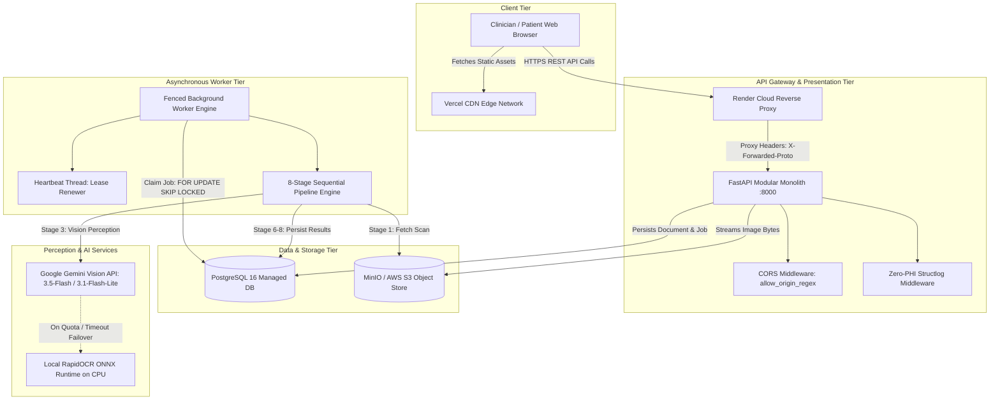
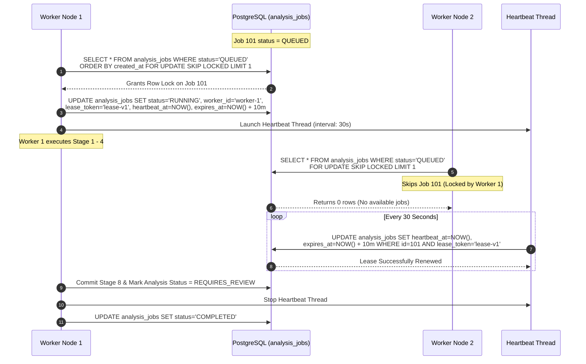
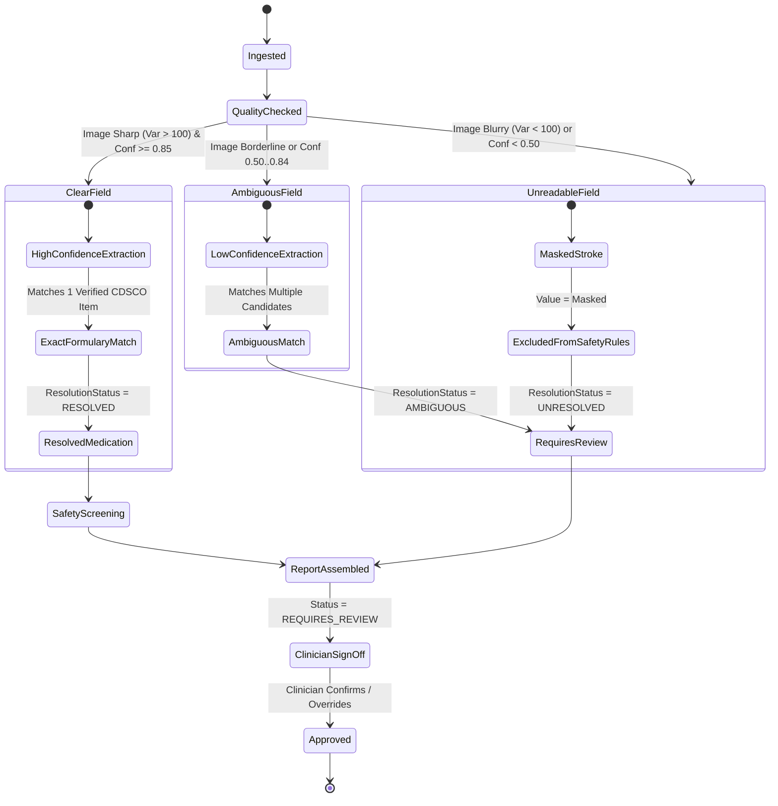

# Prescripto AI 2.0 — System Architecture Dossier

**Document ID:** `DOC-04-ARCH`  
**Classification:** Academic Engineering Dossier  
**Canonical Spec Reference:** [docs/Architecture.md](file:///c:/Users/pbhus/Desktop/Priscption-project/Prescripto-2.0/docs/Architecture.md), [docs/PROJECT-SPEC.md](file:///c:/Users/pbhus/Desktop/Priscption-project/Prescripto-2.0/docs/PROJECT-SPEC.md)  
**Date of Extraction:** November 4, 2026  

---

## 1. Architectural Philosophy and Style

Prescripto AI 2.0 is engineered as a **Hexagonal / Clean Architecture (Modular Monolith)** coupled to an **Asynchronous Fenced Worker Subsystem**:

```
┌────────────────────────────────────────────────────────────────────────┐
│                          PRESENTATION LAYER                            │
│  React 19 SPA (Vercel)  /  FastAPI RESTful Web Endpoints (Render)      │
└───────────────────────────────────┬────────────────────────────────────┘
                                    │ Calls Use Cases
┌───────────────────────────────────▼────────────────────────────────────┐
│                          APPLICATION LAYER                             │
│  Use Cases (IngestPrescription, SubmitReview, RequestDeletion, etc.)   │
│  Application Services (MedicationSearchService, LLMExplainerService)   │
└───────────────────────────────────┬────────────────────────────────────┘
                                    │ Orchestrates
┌───────────────────────────────────▼────────────────────────────────────┐
│                            DOMAIN LAYER                                │
│  Pure Domain Logic (Zero External Framework Dependencies):             │
│  - 4-State Field Uncertainty Model (CLEAR, AMBIGUOUS, UNREADABLE, etc.)│
│  - Deterministic Safety Engines (Duplicates, Allergies, Dosages)       │
│  - Review Trigger Rule Evaluators                                      │
└───────────────────────────────────▲────────────────────────────────────┘
                                    │ Implements Ports
┌───────────────────────────────────┴────────────────────────────────────┐
│                        INFRASTRUCTURE LAYER                            │
│  - Database: SQLAlchemy ORM, Alembic Migrations, PostgreSQL 16 Engine │
│  - Queue: PostgreSQL FOR UPDATE SKIP LOCKED with Fencing Tokens        │
│  - Object Store: S3/MinIO Boto3 Client with HMAC-SHA256 Signing       │
│  - Perception: Gemini Vision SDK, Local RapidOCR ONNX Runtime          │
│  - Audit: Zero-PHI Structlog Filter with Whitelist Enforcement         │
└────────────────────────────────────────────────────────────────────────┘
```

### Architectural Guarantees
1. **Separation of Concerns**: The Domain layer (`backend/prescripto/domain/`) has zero dependencies on FastAPI, SQLAlchemy, or Boto3. It can be compiled and verified completely in isolation.
2. **Deterministic Safety Decoupling**: Probabilistic vision models (Gemini / PaddleOCR) are strictly confined to perception. No neural model makes final decisions on drug-drug interactions, duplicate therapies, or dosage violations.
3. **Audit Immutability**: Once an analysis is finalized by a clinician sign-off (`REVIEWED_COMPLETE`), the database locks the record against any subsequent programmatic modification.

---

## 2. End-to-End System Component Architecture



---

## 3. Asynchronous Execution & Generation Fencing Model

To prevent duplicate job processing and race conditions without adding Redis or Celery overhead, Prescripto AI 2.0 leverages PostgreSQL's native row-level concurrency primitives:



### The Worker Fencing Guarantee (`WorkerFencedError`)
If Worker 1 experiences a long GC pause or network partition exceeding `lease_seconds` (10 minutes), Worker 2 can reclaim the job. When Worker 1 recovers and attempts to commit its next stage result, the query validates:
```sql
UPDATE analysis_jobs 
SET heartbeat_at = NOW() 
WHERE id = :job_id AND lease_token = :my_token;
```
If `rowcount == 0`, Worker 1 raises `WorkerFencedError`, immediately rolls back its transaction, and ceases execution, guaranteeing that stale workers never corrupt pipeline state.

---

## 4. Uncertainty Propagation Architecture

The pipeline enforces an explicit mathematical contract across all 8 stages:



---

## 5. Deployment Topology

The production architecture utilizes a resilient multi-cloud split topology:

```
┌───────────────────────────────────────┐
│         VERCEL EDGE NETWORK           │
│  - Static SPA Web Hosting             │
│  - Global CDN & Brotli Compression    │
│  - Rewrites: /* -> /index.html        │
│  - Inlined VITE_API_BASE_URL          │
└──────────────────┬────────────────────┘
                   │ HTTPS API Traffic
┌──────────────────▼────────────────────┐
│      RENDER CLOUD (Oregon, US)        │
│                                       │
│  [Web Service: prescripto-2-0]        │
│  - Docker Multi-Stage Container       │
│  - Uvicorn ASGI on Port 10000         │
│  - Background Worker Daemon Thread    │
│                                       │
│  [Managed Relational Database]        │
│  - PostgreSQL 16 Server               │
│  - SSL Mode: Required                 │
│  - Connection Pool Timeout: 30s       │
└──────────────────┬────────────────────┘
                   │
┌──────────────────▼────────────────────┐
│        EXTERNAL AI PROVIDERS          │
│  - Google Gemini 3.5 Flash API        │
│  - Google Gemini 3.1 Flash Lite API   │
└───────────────────────────────────────┘
```

