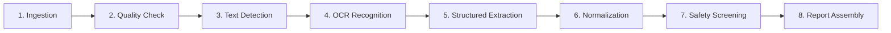

# Prescripto AI 2.0 — Module-by-Module Implementation Dossier

**Document ID:** `DOC-05-MOD`  
**Classification:** Academic Engineering Dossier  
**Canonical Spec Reference:** [backend/prescripto/](file:///c:/Users/pbhus/Desktop/Priscption-project/Prescripto-2.0/backend/prescripto/), [web/src/](file:///c:/Users/pbhus/Desktop/Priscption-project/Prescripto-2.0/web/src/)  
**Date of Extraction:** November 4, 2026  

---

## 1. Module Inventory & Structural Map

```
backend/prescripto/
├── api/                  # HTTP Delivery Mechanism (FastAPI routers & Pydantic schemas)
├── application/          # Use Cases, Orchestration & Domain-to-Storage Bridges
├── audit/                # Structured Logging & PHI Whitelist Enforcement
├── auth/                 # Identity, Cryptography, Password Hashing, JWT Lifecycle
├── config/               # Pydantic Settings, Environment Normalization, Auto-Healing Keys
├── db/                   # Database Models, Session Factory, Connection Pools, Migrations
├── domain/               # Pure Core Domain Entities, Uncertainty Logic & Safety Engines
├── knowledge/            # Pharmacological References (CDSCO, Lexicomp, OpenFDA)
├── ml/                   # Multi-Tier Vision Adapters (Gemini Vision, RapidOCR, Preprocessing)
├── pipeline/             # 8-Stage Sequential Execution Pipeline Engine
├── retention/            # DPDPA 2023 Verifiable Deletion & Cryptographic Shredding
├── storage/              # S3/MinIO Object Storage Client & HMAC Presigned Signer
└── worker/               # Distributed Job Queue Poller, Heartbeat Leases, Coordinator
```

---

## 2. API & Routing Subsystem (`prescripto.api`)

### 2.1. Application Entrypoint (`prescripto.api.main`)
* **Primary Source File:** [backend/prescripto/api/main.py](file:///c:/Users/pbhus/Desktop/Priscption-project/Prescripto-2.0/backend/prescripto/api/main.py)
* **Core Responsibilities:**
  1. Bootstraps the FastAPI application instance with title, version (`1.0.0`), and OpenAPI discovery paths.
  2. Configures CORS middleware supporting explicit origins, localhost ports (`3000`, `5173`), and dynamic matching for all Vercel domains via `allow_origin_regex=r"https?://.*"`.
  3. Registers HTTP middleware (`request_middleware`) enforcing `X-Request-ID` correlation, measuring execution duration (`duration_ms`), and applying security headers (`X-Content-Type-Options: nosniff`, `X-Frame-Options: SAMEORIGIN`, `Strict-Transport-Security: max-age=31536000`).
  4. Provides root discovery endpoints: `GET /`, `GET /api`, and `GET /api/v1` returning API status, health URLs, and available routers.
  5. Mounts static client assets (`/assets`) and provides an SPA client-side fallback route (`/{full_path:path}`) serving `web/dist/index.html` for browser navigation.
  6. Implements canonical error handlers for `StarletteHTTPException`, `RequestValidationError`, and `ApplicationException` mapping failures into the unified `{ "error": { "code", "message", "request_id" } }` envelope.

### 2.2. Authentication Router (`prescripto.api.v1.routers.auth`)
* **Primary Source File:** [backend/prescripto/api/v1/routers/auth.py](file:///c:/Users/pbhus/Desktop/Priscption-project/Prescripto-2.0/backend/prescripto/api/v1/routers/auth.py)
* **Endpoints Implemented:**
  * `POST /api/v1/auth/token`: OAuth2 password flow issuing RS256 token pairs.
  * `POST /api/v1/auth/doctor/login`: Staff login via email and password (e.g. `doctor.sharma@prescripto.local` / `DoctorPass123!`).
  * `POST /api/v1/auth/send-otp`: Dispatches a 6-digit OTP to patient phone numbers (in test mode, defaults to `123456`).
  * `POST /api/v1/auth/verify-otp`: Validates patient mobile code with sliding-window attempt rate limiting and issues a `Role.PATIENT` access token.
  * `POST /api/v1/auth/refresh`: Accepts an unexpired refresh token, validates against `TokenBlocklist`, and issues fresh credentials.
  * `GET /api/v1/auth/me`: Returns the authenticated user's profile and active role.

### 2.3. Prescription Ingestion Router (`prescripto.api.v1.routers.prescriptions`)
* **Primary Source File:** [backend/prescripto/api/v1/routers/prescriptions.py](file:///c:/Users/pbhus/Desktop/Priscption-project/Prescripto-2.0/backend/prescripto/api/v1/routers/prescriptions.py)
* **Endpoints Implemented:**
  * `POST /api/v1/prescriptions`: Accepts multipart form uploads with file validation, calculates SHA-256 hash, checks `Idempotency-Key` header, streams image to S3/MinIO, records row in `prescription_documents`, enqueues an `analysis_jobs` entry, and returns `HTTP 202 Accepted`.
  * `GET /api/v1/prescriptions`: Lists prescription records scoped by role (patients see only their own uploads; clinicians see all clinic uploads).
  * `GET /api/v1/prescriptions/{id}`: Returns prescription metadata and a 60-second presigned URL to view the original scan.
  * `DELETE /api/v1/prescriptions/{id}`: Enqueues an asynchronous DPDPA verifiable deletion request (restricted to `Role.ADMIN`).

### 2.4. Analysis & Review Router (`prescripto.api.v1.routers.analyses`)
* **Primary Source File:** [backend/prescripto/api/v1/routers/analyses.py](file:///c:/Users/pbhus/Desktop/Priscption-project/Prescripto-2.0/backend/prescripto/api/v1/routers/analyses.py)
* **Endpoints Implemented:**
  * `GET /api/v1/analyses/{id}`: Polling endpoint returning active pipeline stage, job status (`QUEUED`, `RUNNING`, `COMPLETED`, `FAILED`), and review requirements.
  * `GET /api/v1/analyses/{id}/result`: Returns structured extractions, field states, CDSCO normalization status, and safety risk findings.
  * `POST /api/v1/analyses/{id}/review`: Clinician sign-off endpoint accepting decisions (`APPROVE`, `FLAG`, `ESCALATE`) and notes per finding, transitioning status to `REVIEWED_COMPLETE`.
  * `PATCH /api/v1/analyses/{id}/medications`: Clinician inline correction endpoint allowing manual edits of drug names, dosages, and instructions.
  * `GET /api/v1/analyses/{id}/clinical-summary`: Returns a plain-language summary formatted for patient comprehension.

---

## 3. The 8-Stage Pipeline Engine (`prescripto.pipeline.engine`)

* **Primary Source File:** [backend/prescripto/pipeline/engine.py](file:///c:/Users/pbhus/Desktop/Priscption-project/Prescripto-2.0/backend/prescripto/pipeline/engine.py)



### Stage Details and Code Logic
1. **Stage 1 — `handle_ingestion`**:
   * Retrieves binary image from object storage via `storage_client.get_object(storage_key)`.
   * Computes SHA-256 hash and compares against `file_hash_sha256` recorded at upload time. Mismatches abort immediately.
2. **Stage 2 — `handle_quality_check`**:
   * Verifies minimum dimensions ($\ge 400 \times 400\text{ px}$).
   * Evaluates image variance using OpenCV Laplacian operator (`cv2.Laplacian(gray, cv2.CV_64F).var()`). Scores $< 100.0$ trigger `sharp_ok = False`.
   * Evaluates mean luminance histogram. Intensity $< 20.0$ triggers `exposure_ok = False`.
   * Quality failures set `context["quality_failed"] = True`, which forces downstream review.
3. **Stage 3 — `handle_text_detection`**:
   * Passes image bytes to the active `RecognitionProvider`.
   * Runs Gemini 3.5 Flash (`gemini-3.5-flash`) by default; falls back to Gemini 3.1 Flash-Lite on quota warnings, or local `RapidOCRRuntime` on network/auth error.
4. **Stage 4 — `handle_ocr_recognition`**:
   * Maps recognized bounding boxes and tokens to line indices.
   * Preserves model provenance metadata (`provider_used`, `model_used`, `attempts`, `fallback_occurred`).
5. **Stage 5 — `handle_structured_extraction`**:
   * Emits structured rows into `prescription_medications`.
   * Extracts 8 discrete fields per medicine: `name`, `strength`, `dose`, `unit`, `route`, `frequency`, `duration`, `instructions`.
   * Assigns 4-state uncertainty taxonomy: `CLEAR`, `AMBIGUOUS`, `UNREADABLE`, `NOT_PRESENT`.
   * Filters out hospital headers, doctor degrees, clinic phone numbers, and diagnostic notes via `is_form_boilerplate()`.
6. **Stage 6 — `handle_medication_normalization`**:
   * Invokes `MedicationSearchService` executing exact and trigram similarity searches against the CDSCO formulary.
   * If exactly one verified product matches with 100% exact equality, marks `ResolutionStatus.RESOLVED`.
   * If multiple candidate matches exist, marks `ResolutionStatus.AMBIGUOUS`.
   * If zero matches exist, marks `ResolutionStatus.UNRESOLVED`. Never automatically overrides source text.
7. **Stage 7 — `handle_safety_screening`**:
   * Evaluates duplicate medications and active ingredients (`detect_duplicate_medications`).
   * Evaluates single-dose ceiling thresholds across 17 drug classes (`detect_dosage_safety_warnings`).
   * Evaluates patient allergy contraindications against 11 drug families (`detect_allergy_contraindications`).
8. **Stage 8 — `handle_report_assembly`**:
   * Gathers all stage outputs, field states, and risk findings.
   * Evaluates review triggers (`evaluate_review_triggers`).
   * Sets final status to `REQUIRES_REVIEW` if any ambiguity or finding is present, or `COMPLETED`.

---

## 4. Deterministic Clinical Safety Engines (`prescripto.domain.safety`)

### 4.1. Duplicate Medication & Active Ingredient Detector (`duplicate.py`)
* **Primary Source File:** [backend/prescripto/domain/safety/duplicate.py](file:///c:/Users/pbhus/Desktop/Priscption-project/Prescripto-2.0/backend/prescripto/domain/safety/duplicate.py)
* **Implementation Logic:**
  * Unresolved or ambiguous lines emit a `NOT_EVALUATED` finding with reason `UNRESOLVED_IDENTITY`, ensuring the doctor is explicitly alerted that safety checking could not run.
  * For resolved lines, pairs are compared for:
    1. **Identical Canonical Product ID**: Flags repeated prescriptions of the same branded product.
    2. **Active Ingredient Overlap**: Intersects normalized active ingredient sets:
       $$\text{ingr}_1 \cap \text{ingr}_2 \neq \emptyset$$
       Flags co-prescriptions sharing molecules (e.g., *Dolo 650* and *Combiflam* sharing Paracetamol) with alert code `DUPLICATE_MEDICATION`.

### 4.2. Dosage Threshold Evaluator (`dosage.py`)
* **Primary Source File:** [backend/prescripto/domain/safety/dosage.py](file:///c:/Users/pbhus/Desktop/Priscption-project/Prescripto-2.0/backend/prescripto/domain/safety/dosage.py)
* **Implementation Logic:**
  * Uses regular expression `(\d+(?:\.\d+)?)\s*(?:mg|milligram|mgs)\b` to extract numeric dosages from strength, dose, and name fields.
  * Compares parsed values against maximum single-dose reference table (`DOSAGE_MAX_THRESHOLDS`):
    * Paracetamol: $1000\text{ mg}$
    * Amoxicillin: $1000\text{ mg}$
    * Metformin: $1000\text{ mg}$
    * Azithromycin: $500\text{ mg}$
    * Ciprofloxacin: $750\text{ mg}$
    * Ibuprofen: $800\text{ mg}$
    * Pantoprazole: $80\text{ mg}$
    * Amlodipine: $10\text{ mg}$
    * Cetirizine: $20\text{ mg}$
  * Values exceeding limits emit `FindingStatus.REQUIRES_REVIEW` with code `ADVERSE_EFFECT`.

### 4.3. Patient Allergy Contraindication Engine (`allergy.py`)
* **Primary Source File:** [backend/prescripto/domain/safety/allergy.py](file:///c:/Users/pbhus/Desktop/Priscption-project/Prescripto-2.0/backend/prescripto/domain/safety/allergy.py)
* **Implementation Logic:**
  * Parses patient allergy records into standardized tokens.
  * Cross-references against 11 drug family dictionaries (`ALLERGY_CLASS_CROSS_REFERENCE`):
    * **Penicillin class**: Penicillin, Amoxicillin, Ampicillin, Augmentin, Piperacillin, Clavulanate.
    * **Sulfa class**: Sulfamethoxazole, Bactrim, Septra, Cotrimoxazole.
    * **NSAID class**: Aspirin, Ibuprofen, Naproxen, Diclofenac, Ketorolac, Mefenamic acid.
    * **Cephalosporins**: Cefixime, Ceftriaxone, Cefuroxime, Cephalexin.
    * **Macrolides**: Azithromycin, Clarithromycin, Erythromycin.
    * **Fluoroquinolones**: Ciprofloxacin, Levofloxacin, Ofloxacin.
  * Matches emit `SafetyCheckType.ALLERGY_CONFLICT` with critical review requirement.

---

## 5. Distributed Worker & Concurrency Subsystem (`prescripto.worker`)

* **Primary Source Files:** [backend/prescripto/worker/main.py](file:///c:/Users/pbhus/Desktop/Priscption-project/Prescripto-2.0/backend/prescripto/worker/main.py), [backend/prescripto/worker/queue.py](file:///c:/Users/pbhus/Desktop/Priscption-project/Prescripto-2.0/backend/prescripto/worker/queue.py), [backend/prescripto/worker/heartbeat.py](file:///c:/Users/pbhus/Desktop/Priscption-project/Prescripto-2.0/backend/prescripto/worker/heartbeat.py)
* **Queue Architecture:**
  * Claims jobs via `QueuePoller.claim_next_job`:
    ```sql
    SELECT * FROM analysis_jobs 
    WHERE status = 'QUEUED' 
    ORDER BY created_at ASC 
    FOR UPDATE SKIP LOCKED LIMIT 1;
    ```
  * Assigns unique `worker_id` and generation `lease_token`.
  * Spawns daemon `HeartbeatManager` thread every 30 seconds to refresh `heartbeat_at` and `expires_at`.
  * If a job fails unexpectedly, increments `retry_count`. If `retry_count >= WORKER_MAX_RETRIES` (3), transitions job to `FAILED` and sets analysis to `FAILED_STALLED`.

---

## 6. Object Storage & Ephemeral Signing Subsystem (`prescripto.storage`)

* **Primary Source File:** [backend/prescripto/storage/client.py](file:///c:/Users/pbhus/Desktop/Priscption-project/Prescripto-2.0/backend/prescripto/storage/client.py)
* **Key Mechanisms:**
  1. **Deterministic S3 Keys**: `prescriptions/{document_id}/original.{ext}`.
  2. **Path Traversal Sanitization**: `_resolve_safe_path()` checks that candidate paths are strictly child directories of `_local_dir`, raising `StorageObjectNotFoundException` on `../` sequences.
  3. **HMAC-SHA256 Presigned URLs**: `generate_signed_storage_url()` generates short-lived signed URLs (`/api/v1/storage/{key}?expires={ts}&signature={sig}`) with 60-second validity, preventing unauthorized hotlinking of prescription images.
  4. **Local Fallback**: Automatically creates and writes to `prescripto_storage/` if MinIO/S3 is offline during developer testing.

---

## 7. Data Privacy & Cryptographic Shredding (`prescripto.retention`)

* **Primary Source File:** [backend/prescripto/retention/worker.py](file:///c:/Users/pbhus/Desktop/Priscption-project/Prescripto-2.0/backend/prescripto/retention/worker.py)
* **4-Phase Deletion Protocol (DPDPA 2023 Compliant):**
  * **Phase 1 (`DB_TOMBSTONED`)**: Cascades deletion across document-scoped relational child rows (`analyses`, `prescription_medications`, `medication_candidates`, `risk_findings`, `reviews`, `analysis_stages`). Retains immutable master formulary items.
  * **Phase 2 (`STORAGE_DELETING`)**: Purges binary prescription image and any cropped line artifacts from S3/MinIO buckets.
  * **Phase 3 (`VERIFYING`)**: Performs read-after-delete verification to confirm zero DB records and zero storage keys remain.
  * **Phase 4 (`COMPLETE`)**: Generates an HMAC-SHA256 cryptographically signed deletion certificate manifest and stores it in `RETENTION_VAULT_BUCKET`.

---

## 8. Frontend Single-Page Application (`web/src`)

* **Component Hierarchy & Key Pages:**
  * [LoginPage.tsx](file:///c:/Users/pbhus/Desktop/Priscption-project/Prescripto-2.0/web/src/pages/LoginPage.tsx): Dual-mode login (Doctor/Staff email+password with 1-click demo autofill; Patient mobile OTP with test mode code `123456`).
  * [UploadPrescriptionPage.tsx](file:///c:/Users/pbhus/Desktop/Priscption-project/Prescripto-2.0/web/src/pages/UploadPrescriptionPage.tsx): Drag-and-drop prescription scan upload with client-side file pre-validation, idempotency key generation, and stage progress redirect.
  * [AnalysisDetailPage.tsx](file:///c:/Users/pbhus/Desktop/Priscption-project/Prescripto-2.0/web/src/pages/AnalysisDetailPage.tsx): Dual-pane clinical workspace with pan/zoom scan viewer, confidence badges, inline drug name editor ([EditMedicineModal.tsx](file:///c:/Users/pbhus/Desktop/Priscption-project/Prescripto-2.0/web/src/components/EditMedicineModal.tsx)), safety alerts drawer, and clinical sign-off buttons (`APPROVE`, `FLAG`, `ESCALATE`).
  * [PatientPortalPage.tsx](file:///c:/Users/pbhus/Desktop/Priscption-project/Prescripto-2.0/web/src/pages/PatientPortalPage.tsx): High-contrast patient dashboard grouping medicines by timing (Morning, Afternoon, Night, SOS) and food instructions, featuring Web Speech API multilingual read-out in English, Hindi, Gujarati, and Marathi.
  * [ReviewQueuePage.tsx](file:///c:/Users/pbhus/Desktop/Priscption-project/Prescripto-2.0/web/src/pages/ReviewQueuePage.tsx): Review queue table listing prescriptions requiring physician verification.
  * [SystemHealthPage.tsx](file:///c:/Users/pbhus/Desktop/Priscption-project/Prescripto-2.0/web/src/pages/SystemHealthPage.tsx): Live diagnostic monitoring dashboard querying `/health` and `/health/db`.

