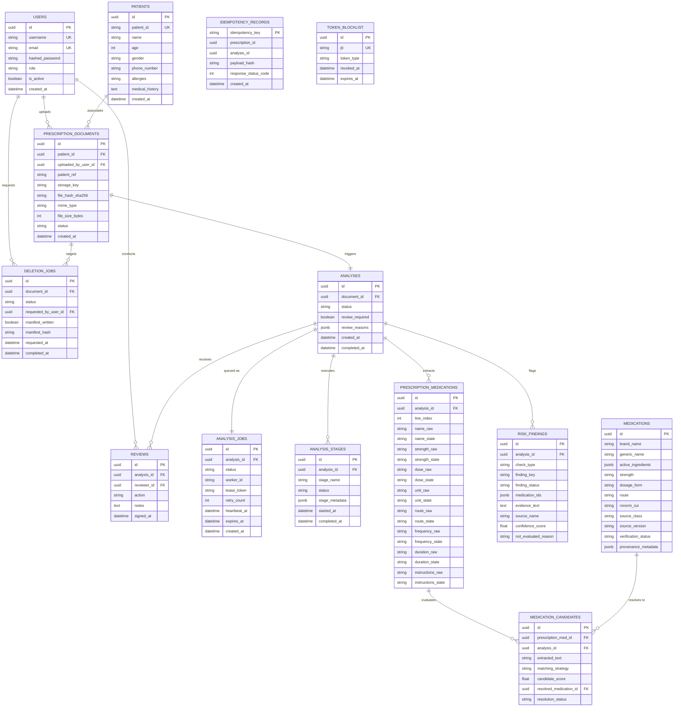

# Prescripto AI 2.0 — Database Design & Data Modeling Dossier

**Document ID:** `DOC-06-DB`  
**Classification:** Academic Engineering Dossier  
**Canonical Spec Reference:** [backend/prescripto/db/models/](file:///c:/Users/pbhus/Desktop/Priscption-project/Prescripto-2.0/backend/prescripto/db/models/), [docs/DATABASE-DESIGN.md](file:///c:/Users/pbhus/Desktop/Priscption-project/Prescripto-2.0/docs/DATABASE-DESIGN.md)  
**Date of Extraction:** November 4, 2026  

---

## 1. Database Technology & Connection Configuration

* **Database Engine:** PostgreSQL 16 (`postgres:16-alpine` on Docker Compose / Render Managed PostgreSQL).
* **ORM & Tooling:** SQLAlchemy 2.0.35 + Alembic 1.20.0 for schema versioning.
* **Driver:** `psycopg2-binary` (v2.9.10).
* **Connection Pool Optimization (Render Free-Tier Guard):**
  * `pool_size = 10`
  * `max_overflow = 20`
  * `pool_pre_ping = True` (Tests liveness before handing connections to requests)
  * `pool_recycle = 1800` (Recycles idle connections every 30 minutes to prevent drops by cloud load balancers)
  * `pool_timeout = 30` (Seconds before throwing connection acquisition timeout)
* **Local Development Driver:** SQLite 3 with `check_same_thread = False` for hermetic unit testing.

---

## 2. Complete Entity-Relationship (ER) Diagram

---

## 3. Detailed Table Schema Definitions

### 3.1. `users` Table
Stores system identity credentials and clinical roles.
* `id` (`UUID`, Primary Key, default `gen_random_uuid()`)
* `username` (`VARCHAR(64)`, Unique, Non-nullable, Indexed)
* `email` (`VARCHAR(255)`, Unique, Non-nullable, Indexed)
* `hashed_password` (`VARCHAR(255)`, Non-nullable): Salted bcrypt password hash.
* `role` (`VARCHAR(32)`, Non-nullable): Enum `OPERATOR`, `REVIEWER`, `ADMIN`, `PATIENT`.
* `is_active` (`BOOLEAN`, Non-nullable, default `True`)
* `created_at` (`TIMESTAMPTZ`, Non-nullable, default `NOW()`)

### 3.2. `patients` Table
Records de-identified patient demographic and clinical history.
* `id` (`UUID`, Primary Key)
* `patient_id` (`VARCHAR(64)`, Unique, Non-nullable, Indexed): External clinic MRN/ID.
* `name` (`VARCHAR(255)`, Non-nullable)
* `age` (`INTEGER`, Nullable)
* `gender` (`VARCHAR(16)`, Nullable): `MALE`, `FEMALE`, `OTHER`.
* `phone_number` (`VARCHAR(32)`, Nullable, Indexed): Used for patient OTP matching.
* `allergies` (`TEXT`, Nullable): Comma/line-separated known drug allergen tokens.
* `medical_history` (`TEXT`, Nullable): Chronic conditions (e.g., Hypertension, Diabetes).
* `created_at` (`TIMESTAMPTZ`, Non-nullable, default `NOW()`)

### 3.3. `prescription_documents` Table
Represents an ingested prescription document artifact.
* `id` (`UUID`, Primary Key)
* `patient_id` (`UUID`, Nullable, Foreign Key &rarr; `patients.id`)
* `uploaded_by_user_id` (`UUID`, Non-nullable, Foreign Key &rarr; `users.id`)
* `patient_ref` (`VARCHAR(64)`, Nullable): Correlation identifier.
* `storage_key` (`VARCHAR(512)`, Non-nullable): S3 object key.
* `file_hash_sha256` (`CHAR(64)`, Non-nullable): Binary payload cryptographic hash.
* `mime_type` (`VARCHAR(64)`, Non-nullable): `image/jpeg`, `image/png`, `image/tiff`.
* `file_size_bytes` (`INTEGER`, Non-nullable): Validated $\le 20\text{ MB}$.
* `status` (`VARCHAR(32)`, Non-nullable): Enum `RECEIVED`, `STORED`, `DELETED`.
* `created_at` (`TIMESTAMPTZ`, Non-nullable, default `NOW()`)

### 3.4. `analyses` Table
Master clinical analysis record tracking pipeline state and review status.
* `id` (`UUID`, Primary Key)
* `document_id` (`UUID`, Non-nullable, Foreign Key &rarr; `prescription_documents.id`, Unique)
* `status` (`VARCHAR(32)`, Non-nullable): `PENDING`, `PROCESSING`, `REQUIRES_REVIEW`, `COMPLETED`, `FAILED_STALLED`, `REVIEWED_COMPLETE`.
* `review_required` (`BOOLEAN`, Non-nullable, default `False`)
* `review_reasons` (`JSONB`, Nullable): Array of triggered review reason strings.
* `created_at` (`TIMESTAMPTZ`, Non-nullable, default `NOW()`)
* `completed_at` (`TIMESTAMPTZ`, Nullable)

### 3.5. `analysis_jobs` Table (The Asynchronous Queue)
High-throughput row-level queue queried via `FOR UPDATE SKIP LOCKED`.
* `id` (`UUID`, Primary Key)
* `analysis_id` (`UUID`, Non-nullable, Foreign Key &rarr; `analyses.id`, Unique)
* `status` (`VARCHAR(32)`, Non-nullable, Indexed): `QUEUED`, `RUNNING`, `COMPLETED`, `FAILED`.
* `worker_id` (`VARCHAR(64)`, Nullable): Hostname + PID of the processing worker.
* `lease_token` (`VARCHAR(64)`, Nullable): Monotonic generation fencing token.
* `retry_count` (`INTEGER`, Non-nullable, default `0`)
* `heartbeat_at` (`TIMESTAMPTZ`, Nullable)
* `expires_at` (`TIMESTAMPTZ`, Nullable, Indexed): Timestamp when worker lease lapses.
* `created_at` (`TIMESTAMPTZ`, Non-nullable, default `NOW()`)

### 3.6. `medications` Table (Formulary Master)
CDSCO verified pharmacological drug catalogue.
* `id` (`UUID`, Primary Key)
* `brand_name` (`VARCHAR(255)`, Non-nullable, Indexed)
* `generic_name` (`VARCHAR(255)`, Non-nullable, Indexed)
* `active_ingredients` (`JSONB` / `ARRAY`, Non-nullable): Array of chemical strings.
* `strength` (`VARCHAR(64)`, Nullable)
* `dosage_form` (`VARCHAR(64)`, Nullable): `Tablet`, `Capsule`, `Syrup`, `Injection`.
* `route` (`VARCHAR(64)`, Nullable): `Oral`, `Topical`, `Inhalation`, `Ophthalmic`.
* `rxnorm_cui` (`VARCHAR(32)`, Nullable): Standardized RxNorm CUI concept identifier.
* `source_class` (`VARCHAR(64)`, Non-nullable): `CDSCO_REGULATORY`.
* `source_version` (`VARCHAR(32)`, Non-nullable, default `"2024.1"`)
* `verification_status` (`VARCHAR(32)`, Non-nullable): `VERIFIED_AUTHORITY`.
* `provenance_metadata` (`JSONB`, Nullable)

### 3.7. `prescription_medications` Table
Structured clinical extractions preserving field-level uncertainty.
* `id` (`UUID`, Primary Key)
* `analysis_id` (`UUID`, Non-nullable, Foreign Key &rarr; `analyses.id`, Indexed)
* `line_index` (`INTEGER`, Non-nullable)
* 8 Structured Fields each with raw string, uncertainty state, and confidence:
  * `name_raw`, `name_state` (`CLEAR`/`AMBIGUOUS`/`UNREADABLE`/`NOT_PRESENT`), `name_confidence`
  * `strength_raw`, `strength_state`, `strength_confidence`
  * `dose_raw`, `dose_state`, `dose_confidence`
  * `unit_raw`, `unit_state`, `unit_confidence`
  * `route_raw`, `route_state`, `route_confidence`
  * `frequency_raw`, `frequency_state`, `frequency_confidence`
  * `duration_raw`, `duration_state`, `duration_confidence`
  * `instructions_raw`, `instructions_state`, `instructions_confidence`

### 3.8. `risk_findings` Table
Clinical safety warnings generated by deterministic domain engines.
* `id` (`UUID`, Primary Key)
* `analysis_id` (`UUID`, Non-nullable, Foreign Key &rarr; `analyses.id`, Indexed)
* `check_type` (`VARCHAR(64)`, Non-nullable): `DUPLICATE_MEDICATION`, `ADVERSE_EFFECT`, `ALLERGY_CONFLICT`.
* `finding_key` (`VARCHAR(128)`, Non-nullable): Unique hash preventing duplicate findings.
* `finding_status` (`VARCHAR(32)`, Non-nullable): `POTENTIAL`, `REQUIRES_REVIEW`, `NOT_EVALUATED`.
* `medication_ids` (`JSONB` / `ARRAY`, Non-nullable): Foreign IDs of implicated medicine lines.
* `evidence_text` (`TEXT`, Non-nullable): Human-readable clinical rationale.
* `source_name` (`VARCHAR(64)`, Non-nullable): `PRESCRIPTO_DETERMINISTIC_RULES`.
* `confidence_score` (`FLOAT`, Nullable)
* `not_evaluated_reason` (`VARCHAR(64)`, Nullable): `UNRESOLVED_IDENTITY`, `AMBIGUOUS_IDENTITY`.

---

## 4. Alembic Migration History

The schema evolution is tracked under [backend/prescripto/db/migrations/versions/](file:///c:/Users/pbhus/Desktop/Priscption-project/Prescripto-2.0/backend/prescripto/db/migrations/versions/):

1. **`0001_initial_schema.py`** (`rev = '0001'`):
   * Establishes core enum types: `fieldstate`, `resolutionstatus`, `findingstatus`, `safetychecktype`, `analysisstatus`, `jobstatus`, `documentstatus`, `role`.
   * Creates initial tables: `users`, `prescription_documents`, `analyses`, `analysis_jobs`, `analysis_stages`, `medications`, `prescription_medications`, `medication_candidates`, `risk_findings`, `reviews`, `model_versions`, `token_blocklist`, `deletion_jobs`, `audit_events`.
2. **`0002_idempotency_records.py`** (`rev = '0002'`, down-revision `'0001'`):
   * Creates `idempotency_records` table to support HTTP `Idempotency-Key` tracking and prevent upload replay race conditions.
3. **`0003_add_patients_table.py`** (`rev = '0003'`, down-revision `'0002'`):
   * Creates `patients` table with unique constraint on `patient_id`.
   * Safely adds `patient_id` foreign key column to `prescription_documents`.
   * Conditionally updates PostgreSQL `role` enum type to include `'PATIENT'`.

