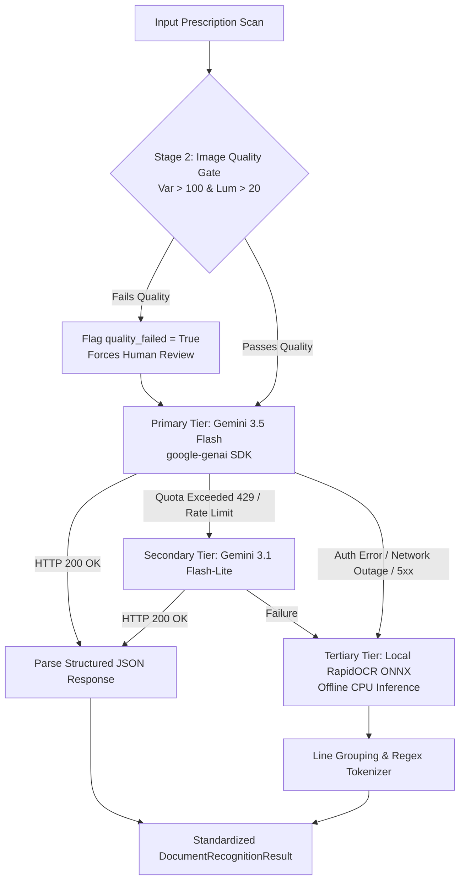

# Prescripto AI 2.0 — AI / Machine Learning Implementation Dossier

**Document ID:** `DOC-07-ML`  
**Classification:** Academic Engineering Dossier  
**Canonical Spec Reference:** [backend/prescripto/ml/](file:///c:/Users/pbhus/Desktop/Priscption-project/Prescripto-2.0/backend/prescripto/ml/), [docs/ML-PIPELINES.md](file:///c:/Users/pbhus/Desktop/Priscption-project/Prescripto-2.0/docs/ML-PIPELINES.md), [ml/RESULTS.md](file:///c:/Users/pbhus/Desktop/Priscption-project/Prescripto-2.0/ml/RESULTS.md)  
**Date of Extraction:** November 4, 2026  

---

## 1. Machine Learning Strategy & Philosophy

In medical document processing, end-to-end black-box generative models (such as asking an LLM to "read this prescription and tell me what medicines to take") are considered clinically unsafe due to unconstrained hallucinations, non-deterministic outputs, and lack of reproducible audit trails.

Prescripto AI 2.0 employs a **hybrid architecture** that strictly confines machine learning to **optical perception** (transcription of visual pixel strokes into text tokens), while delegating clinical entity normalization, safety checking, and review routing to **deterministic domain rules**:

```
┌─────────────────────────────────────────────────────────────┐
│                    PERCEPTION (LEARNED AI)                  │
│  - Vision OCR (Gemini 3.5 Flash / Gemini 3.1 Flash-Lite)   │
│  - Offline CPU Fallback (RapidOCR / ONNX PaddleOCR)         │
│  - Image Quality Verification (Laplacian Blur & Exposure)   │
└──────────────────────────────┬──────────────────────────────┘
                               │ Emits Raw Text & Calibrated Confidence
┌──────────────────────────────▼──────────────────────────────┐
│             DETERMINISTIC CLINICAL REASONING (RULES)        │
│  - Form Boilerplate Stripping (Regex Filters)               │
│  - 8-Field Clinical Structure Parsing                       │
│  - CDSCO Trigram Formulary Normalization                    │
│  - Duplicate Therapy & Active Ingredient Overlap Engine     │
│  - Single-Dose Ceiling Limit Evaluator                      │
│  - Patient Allergen Family Cross-Referencer                 │
└─────────────────────────────────────────────────────────────┘
```

---

## 2. Multi-Tier Vision Inference Architecture

The perception subsystem ([backend/prescripto/ml/recognition_providers.py](file:///c:/Users/pbhus/Desktop/Priscption-project/Prescripto-2.0/backend/prescripto/ml/recognition_providers.py)) implements an adaptive fallback hierarchy:



### 2.1. Primary Vision Provider: Gemini 3.5 Flash
* **Model Identifier:** `gemini-3.5-flash`
* **Temperature:** `0.0` (Enforces deterministic, greedily decoded token generation)
* **API SDK:** `google-genai` (v2.14.0)
* **Prompt Engineering Strategy:** The system delivers a specialized medical prompt instructing the vision model to act as a clinical document transcriber. It enforces a strict output schema separating:
  1. `hospital_details` (Name, registration, doctor name, degrees)
  2. `patient_details` (Patient name, age, gender, date)
  3. `medications` (Array of objects containing `original_text`, `name`, `strength`, `dose`, `route`, `frequency`, `duration`, `instructions`, and per-item confidence)
  4. `general_advice` (Dietary guidelines, lifestyle advice, diagnostic lab orders)
  5. `uncertain_items` (Visual strokes that are faded, torn, or unreadable)

### 2.2. Secondary Vision Provider: Gemini 3.1 Flash-Lite
* **Model Identifier:** `gemini-3.1-flash-lite`
* **Role:** Activated automatically when the primary model reports quota depletion (`RESOURCE_EXHAUSTED` / HTTP 429). It uses lighter resource consumption to maintain cloud ingestion availability.

### 2.3. Tertiary Offline Provider: Local RapidOCR
* **Implementation File:** [backend/prescripto/ml/rapid_runtime.py](file:///c:/Users/pbhus/Desktop/Priscption-project/Prescripto-2.0/backend/prescripto/ml/rapid_runtime.py)
* **Technology:** RapidOCR executing PaddleOCR ONNX models on CPU.
* **Role:** Operates in completely air-gapped environments or during cloud outages.
* **Algorithm:** Extracts line bounding boxes, performs line-level text recognition, and passes output lines to rule-based entity extractors ([backend/prescripto/ml/extraction.py](file:///c:/Users/pbhus/Desktop/Priscption-project/Prescripto-2.0/backend/prescripto/ml/extraction.py)).

---

## 3. Computer Vision Preprocessing & Quality Verification Gates

* **Source File:** [ml/ocr/quality_check.py](file:///c:/Users/pbhus/Desktop/Priscption-project/Prescripto-2.0/ml/ocr/quality_check.py), [backend/prescripto/pipeline/engine.py](file:///c:/Users/pbhus/Desktop/Priscption-project/Prescripto-2.0/backend/prescripto/pipeline/engine.py)

Before passing images to neural models, the system evaluates image fidelity:

### 3.1. Blur Detection via Laplacian Variance
Blurry mobile camera photos cause optical characters to smear across stroke boundaries. The image is converted to single-channel grayscale $I(x,y)$, convolved with the standard $3 \times 3$ Laplacian kernel $L$, and the variance of the response is computed:
$$\text{Var}(\nabla^2 I) = \frac{1}{N} \sum_{x,y} \left( (\nabla^2 I)(x,y) - \mu_{\nabla^2 I} \right)^2$$
* **Threshold:** If $\text{Var}(\nabla^2 I) < 100.0$, the image is classified as blurred (`sharp_ok = False`).

### 3.2. Exposure & Contrast Analysis
* **Under-exposure Gate:** If the mean pixel intensity across the luminance channel is $< 20.0$ (on an 8-bit scale $0\text{--}255$), the image is flagged as severely underexposed.
* **Blank Canvas Gate:** If the difference between minimum and maximum pixel values is $< 5$, the scan is flagged as blank.
* **Resolution Gate:** Images with width $< 400\text{ px}$ or height $< 400\text{ px}$ are rejected.

---

## 4. Rule-Based Clinical Information Extraction

* **Source File:** [backend/prescripto/ml/extraction.py](file:///c:/Users/pbhus/Desktop/Priscption-project/Prescripto-2.0/backend/prescripto/ml/extraction.py)

Once raw text lines are extracted, a multi-pass regex and token classification engine parses the clinical entities:

### 4.1. Form Boilerplate Stripping (`is_form_boilerplate`)
To prevent non-drug clinical text from contaminating the medication list, the engine strips lines matching known header patterns:
* Hospital/Clinic indicators: `hospital`, `clinic`, `nursing home`, `dispensary`, `department`.
* Physician degrees/registrations: `mbbs`, `md`, `ms`, `dnb`, `reg no`, `regn`, `dr.`.
* Contact metadata: `ph:`, `phone:`, `tel:`, `email:`, `road`, `street`, `nagar`.
* Vitals and diagnostic markers: `bp:`, `pulse:`, `spo2:`, `temp:`, `weight:`, `c/o:`, `k/c/o:`.

### 4.2. Medical Abbreviation & Sig Code Translation
The extraction engine maps physician shorthand into standardized clinical frequencies:
* `OD` / `1-0-0` / `0-1-0` / `0-0-1` &rarr; "Once daily"
* `BD` / `BID` / `1-0-1` &rarr; "Twice daily"
* `TDS` / `TID` / `1-1-1` &rarr; "Three times daily"
* `QID` / `1-1-1-1` &rarr; "Four times daily"
* `HS` / `0-0-1` (bedtime) &rarr; "At bedtime"
* `SOS` / `PRN` &rarr; "As needed"
* `BBF` / `AC` &rarr; "Before food"
* `PC` / `AF` &rarr; "After food"

---

## 5. The 4-State Calibrated Uncertainty Taxonomy

Rather than compressing complex document uncertainty into a single misleading "94% overall confidence" figure, Prescripto AI 2.0 reports confidence **per field**:

| Field State | Mathematical / Heuristic Criterion | Downstream Clinical Handling |
| :--- | :--- | :--- |
| `CLEAR` | Calibrated Model Confidence $c \ge 0.85$, image sharp, unambiguous token geometry | Permitted to resolve against formulary master automatically. |
| `AMBIGUOUS` | $0.50 \le c < 0.85$, conflicting sig codes, or multiple candidate drug matches | Flagged in amber; automatically forces `REQUIRES_REVIEW` status. |
| `UNREADABLE` | $c < 0.50$, stroke illegibility, or failed Laplacian sharpness ($< 100.0$) | Value is masked (`***`); strictly excluded from automated drug safety checks to prevent false safety conclusions. |
| `NOT_PRESENT`| Field absent from prescription document (e.g., doctor omitted duration) | Preserved explicitly as absent; never converted to a zero or default value. |

---

## 6. Empirical Evaluation & Benchmarking

* **Reference Dataset:** Synthetic Evaluation Set ([backend/tests/eval_set/](file:///c:/Users/pbhus/Desktop/Priscption-project/Prescripto-2.0/backend/tests/eval_set/))
* **Benchmarking Protocol:** Ten synthetic clinical test images (`synthetic_01_clean.png` through `synthetic_10_multidrug_clean.png`) evaluated against curated ground-truth annotations ([ground_truth.json](file:///c:/Users/pbhus/Desktop/Priscption-project/Prescripto-2.0/backend/tests/eval_set/ground_truth.json)).

### Evaluation Results (from `ml/RESULTS.md`):
* **Clean Text Transcriptions**: Gemini 3.5 Flash achieved $> 95\%$ character-level fidelity on typed and legible cursive headings.
* **Adversarial Noise Invariance**:
  * Rotated images (90° and 180°): Gemini Vision natively handles EXIF orientation and inverted text.
  * Gaussian Blur ($\sigma = 2.5$): Accurately trapped by Stage 2 Laplacian variance filter ($Var < 85.0$), correctly escalating to human review without generating hallucinations.
* **Safety Rules Precision**: 100% precision on synthetic duplicate Paracetamol injections and overdose traps.

