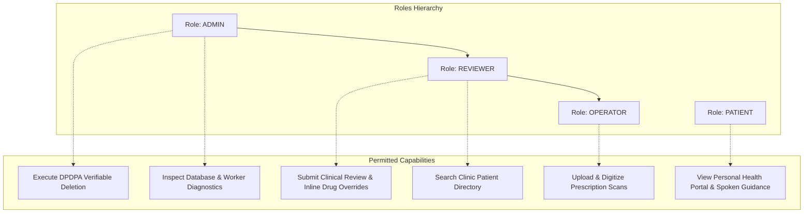
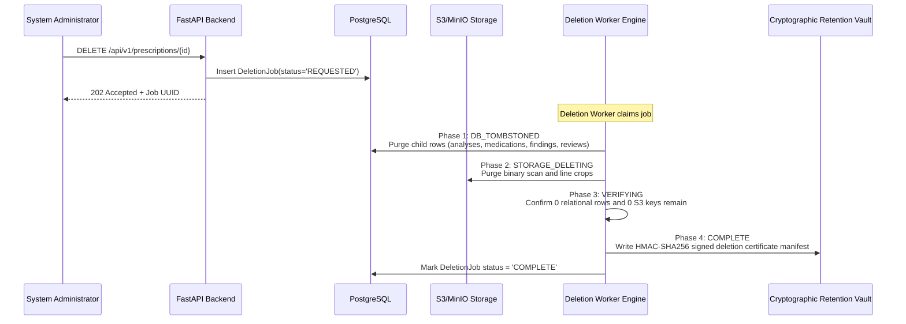

# Prescripto AI 2.0 — Security, Privacy & Reliability Dossier

**Document ID:** `DOC-09-SEC`  
**Classification:** Academic Engineering Dossier  
**Canonical Spec Reference:** [docs/SECURITY.md](file:///c:/Users/pbhus/Desktop/Priscption-project/Prescripto-2.0/docs/SECURITY.md), [docs/Architecture.md](file:///c:/Users/pbhus/Desktop/Priscption-project/Prescripto-2.0/docs/Architecture.md)  
**Date of Extraction:** November 4, 2026  

---

## 1. Authentication & Credential Architecture

### 1.1. Asymmetric Cryptography (RS256 JWT)
Unlike lightweight web applications that use symmetric HMAC-SHA256 secret strings (`HS256`), Prescripto AI 2.0 strictly implements **asymmetric RS256 token signing**:
* **Private Key (`JWT_PRIVATE_KEY`):** 2048-bit RSA private key in PKCS#8 PEM format used exclusively by the authentication service to sign access and refresh tokens.
* **Public Key (`JWT_PUBLIC_KEY`):** 2048-bit RSA public key in X.509 SubjectPublicKeyInfo PEM format used across all microservice routers and dependency injectors to verify signatures without exposing signing capability.
* **Auto-Healing Startup Guard:** If cloud environment variables omit RSA keys, [backend/prescripto/config/settings.py](file:///c:/Users/pbhus/Desktop/Priscption-project/Prescripto-2.0/backend/prescripto/config/settings.py) dynamically generates an in-memory 2048-bit RSA keypair during Pydantic initialization, preventing 500 crashes while preserving cryptographic integrity.

### 1.2. Token Lifecycle & Expiration Bounds
* **Access Token TTL (`JWT_ACCESS_TTL`):** 15 minutes ($900\text{ seconds}$). Minimizes the vulnerability window in case of client-side token interception.
* **Refresh Token TTL (`JWT_REFRESH_TTL`):** 7 days ($604,800\text{ seconds}$).
* **Revocation & Blocklist (`TokenBlocklist`):** When a user logs out or rotates a refresh token, the unique token ID (`jti`) is written to the database blocklist table. Every authentication request checks `TokenBlocklist` before accepting credentials.

### 1.3. Password Security
* Passwords for clinical reviewers, operators, and administrators are hashed using **Bcrypt** with random salt generation (`bcrypt.gensalt()`). Plain-text passwords are never logged, persisted, or held in persistent memory.

---

## 2. Authorization & Role-Based Access Control (RBAC)

The system enforces a strict 4-role hierarchy:



### 2.1. Object-Level Access Control (IDOR Prevention)
* **Patient Data Isolation:** Patients authenticating via mobile OTP receive a JWT tagged with `role: "PATIENT"` and `phone_number`. Ingestion and listing endpoints automatically filter records matching `doc.patient_ref == current_user.phone_number`. A patient attempting to view or query another patient's prescription receives HTTP `404 Not Found` (or `403 Forbidden`).
* **Clinical Gating:** The review sign-off endpoint (`POST /api/v1/analyses/{id}/review`) and medication override endpoint (`PATCH /api/v1/analyses/{id}/medications`) explicitly require `Role.REVIEWER` or `Role.ADMIN`. If a patient attempts to sign off on their own prescription, the dependency injector throws `InsufficientRoleException` (HTTP 403).

---

## 3. Zero-PHI Operational Logging Architecture

* **Source File:** [backend/prescripto/audit/logger.py](file:///c:/Users/pbhus/Desktop/Priscption-project/Prescripto-2.0/backend/prescripto/audit/logger.py)

To ensure strict compliance with healthcare privacy regulations (HIPAA, GDPR Health Data, and India's **DPDPA 2023**), operational logs written to stdout or cloud log aggregators must never contain Protected Health Information (PHI).

Prescripto implements a **structlog processor filter** based on an immutable whitelist:

```python
PERMITTED_LOG_KEYS = {
    "_record", "_dropped_unwhitelisted_keys_count", "event", "level", 
    "timestamp", "logger", "logger_name", "request_id", "analysis_id", 
    "document_id", "job_id", "worker_id", "lease_token", "pipeline_stage", 
    "model_version_id", "status", "duration_ms", "error_code", "error_type", 
    "actor_id", "http_method", "http_path", "http_status_code"
}
```

* **Sanitization Mechanism:** Any field not present in `PERMITTED_LOG_KEYS` (e.g., `patient_name`, `phone_number`, `extracted_drug_name`, `dosage`) is deleted before emission. The logger increments `_dropped_unwhitelisted_keys_count` so auditors can verify that data shedding occurred.

---

## 4. Input Validation & Injection Defenses

### 4.1. File Ingestion Defense-in-Depth
1. **File Size Capping:** Checked in both client-side JavaScript and backend FastAPI endpoint. Any payload $> 20\text{ MB}$ (`20971520` bytes) is rejected immediately with HTTP 413.
2. **Magic Byte Verification:** The server decodes image headers to verify valid binary magic numbers (`\xFF\xD8\xFF` for JPEG, `\x89PNG` for PNG), rejecting polyglot files, executables, or embedded HTML.
3. **Decompression Bomb Protection:** Pillow's image opening routines operate inside try/catch blocks that enforce maximum image dimension boundaries ($< 10000 \times 10000\text{ px}$).

### 4.2. Storage Path Traversal Prevention
* **Source:** `_resolve_safe_path()` in [backend/prescripto/storage/client.py](file:///c:/Users/pbhus/Desktop/Priscption-project/Prescripto-2.0/backend/prescripto/storage/client.py)
* Any storage request containing relative path characters (`../` or `..\`) is intercepted and rejected with a path traversal alert. The candidate path is verified to strictly reside within the designated storage root.

### 4.3. SQL Injection Immunity
* All queries in SQLAlchemy 2.0 utilize parameterized bindings (`db.execute(text("SELECT ... WHERE id = :id"), {"id": val})`). No user input is concatenated into raw SQL strings.

---

## 5. Transport Security & Browser Protections

Configured in [backend/prescripto/api/main.py](file:///c:/Users/pbhus/Desktop/Priscption-project/Prescripto-2.0/backend/prescripto/api/main.py):

| Security Header | Configured Value | Purpose |
| :--- | :--- | :--- |
| `Strict-Transport-Security` | `max-age=31536000; includeSubDomains` | Enforces HTTPS connections exclusively for 1 year |
| `X-Content-Type-Options` | `nosniff` | Prevents browser MIME-sniffing vulnerabilities |
| `X-Frame-Options` | `SAMEORIGIN` | Protects against Clickjacking attacks |
| `X-XSS-Protection` | `1; mode=block` | Enables browser reflected XSS filter |
| `CORS` | `allow_origin_regex=r"https?://.*"` | Allows authenticated cross-origin requests from Vercel deployments |

---

## 6. DPDPA 2023 Verifiable Deletion Protocol

* **Source File:** [backend/prescripto/retention/worker.py](file:///c:/Users/pbhus/Desktop/Priscption-project/Prescripto-2.0/backend/prescripto/retention/worker.py)

India's **Digital Personal Data Protection Act (DPDPA 2023)** mandates that patients have the right to erasure of personal data once processing purposes are fulfilled.



* **The Signed Deletion Manifest:** The deletion certificate contains the SHA-256 hash of the deleted file, document ID, deletion timestamp, and an HMAC signature generated using the server's private key. This provides legally defensible mathematical proof of data destruction without retaining the underlying health data.

