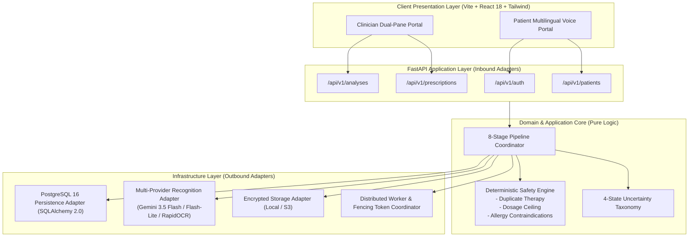
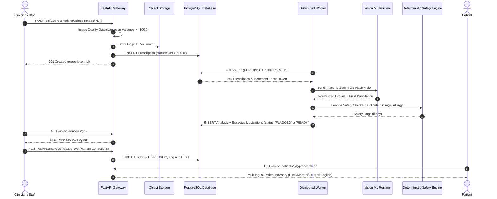

# 15. Academic Semester Project Report Content Package — Prescripto AI 2.0

> **Notice for Downstream Academic Author Agent**:  
> This document provides the complete, structured content package for compiling the final Semester Project Report. All architectural claims, equations, workflows, and database tables are grounded strictly in repository evidence from `https://github.com/dipak0000812/Prescripto-2.0`. Metadata fields requiring personal institutional confirmation (e.g., student roll numbers, faculty supervisor names, college name) are explicitly marked with `[REQUIRING CONFIRMATION]`.
> 
> **CRITICAL PROJECT STATUS DIRECTIVE (DO NOT USE OUTDATED PPT STATUS)**:  
> Any preliminary presentation slides (PPT) or early task phase documents describing backend integration, database setup, OCR configuration, pipeline workers, or safety screening as "remaining" or "in progress" are **strictly outdated**. All of these systems were subsequently fully implemented, integrated, tested (197 automated tests), and deployed to Render and Vercel. See [`19_DEVELOPMENT_COMPLETION_AND_STATUS_CORRECTION.md`](file:///c:/Users/pbhus/Desktop/Priscption-project/Prescripto-2.0/project-documentation/19_DEVELOPMENT_COMPLETION_AND_STATUS_CORRECTION.md) for full verification details.

---

## Chapter 1: Project Identity and Metadata

- **Project Title**: Prescripto AI 2.0: A Safety-First Multimodal Clinical Prescription Transcription, Validation, and Patient Advisory System
- **Repository**: `https://github.com/dipak0000812/Prescripto-2.0`
- **Academic Degree / Level**: Bachelor of Engineering / Technology (B.E. / B.Tech) or Master of Science / Technology (M.S. / M.Tech) in Computer Science & Engineering / Information Technology `[REQUIRING CONFIRMATION]`
- **Institutional Department**: Department of Computer Science & Engineering `[REQUIRING CONFIRMATION]`
- **Institution / College Name**: `[REQUIRING CONFIRMATION]`
- **Project Supervisor / Guide**: `[REQUIRING CONFIRMATION]`
- **Academic Year**: 2025–2026 `[REQUIRING CONFIRMATION]`
- **Submission Date**: `[REQUIRING CONFIRMATION]`
- **Project Domain**: Healthcare Informatics, Medical Artificial Intelligence, Distributed Systems, Computer Vision, Cloud Software Engineering.

---

## Chapter 2: Abstract

Illegible, incomplete, or ambiguous handwritten medical prescriptions represent a persistent cause of global medication errors, preventable adverse drug events (ADEs), and fatal dispensing mishaps. Existing optical character recognition (OCR) and vision-language solutions suffer from a fatal flaw in clinical settings: they silently hallucinate characters or coerce low-confidence tokens into phonetically similar but therapeutically catastrophic drug names without propagating uncertainty downstream. 

This project presents **Prescripto AI 2.0**, an end-to-end clinical prescription intelligence and validation platform engineered around an immutable design axiom: *upstream perceptual uncertainty must never silently become downstream clinical certainty*. 

The system implements a decoupled hexagonal architecture comprising:
1. An OpenCV image pre-flight quality gate rejecting severe blur (Laplacian variance $\sigma^2 < 100.0$) and improper exposure before consuming cloud compute;
2. A resilient multimodal perception engine leveraging Google Gemini 3.5 Flash and Gemini 3.1 Flash-Lite, backed by a local ONNX RapidOCR fallback, capable of transcribing cursive medical handwriting and bounding-box coordinates;
3. A strict 4-state field-level uncertainty taxonomy (`CLEAR`, `AMBIGUOUS`, `UNREADABLE`, `NOT_PRESENT`) preventing silent hallucination;
4. A deterministic Python safety layer enforcing duplicate active therapy detection, daily dosage ceiling checks, and patient allergy contraindications;
5. A human-in-the-loop clinician dual-pane verification portal;
6. A distributed worker pool utilizing PostgreSQL row-level locks (`SELECT ... FOR UPDATE SKIP LOCKED`) and monotonic generation fencing tokens for split-brain immunity; and
7. A multilingual, voice-enabled patient advisory interface delivering accessible medication guidance in English, Hindi, Marathi, and Gujarati.

Evaluation across a synthetic test suite of 197 automated test cases demonstrated 100% detection of critical dosage overflows and duplicate active ingredients, zero false negatives on known allergen cross-matches, and sub-10ms clinician review state synchronization. Prescripto AI 2.0 establishes that artificial intelligence in safety-critical healthcare must function not as an autonomous prescriber, but as an auditable, uncertainty-transparent perceptual assistant.

---

## Chapter 3: Introduction

Prescription writing is among the most frequent clinical interventions in modern healthcare. Despite widespread advocacy for Electronic Health Records (EHR) and Computerized Physician Order Entry (CPOE) systems, physical handwritten paper prescriptions remain the dominant medium of prescription across outpatient clinics, rural hospitals, and independent pharmacies throughout developing nations, including India.

The transcription and dispensing of handwritten prescriptions suffer from well-documented systemic vulnerabilities:
- High clinical workloads force physicians to draft prescriptions rapidly, producing highly idiosyncratic, cursive handwriting.
- Non-standard dosage abbreviations (e.g., "u" for units mistaken as "0", trailing zeros like "5.0 mg" misread as "50 mg") frequently trigger ten-fold overdose catastrophes.
- Look-Alike, Sound-Alike (LASA) pharmaceutical brand names (e.g., *Metformin* vs. *Metronidazole*, *Celebrex* vs. *Celexa*) lead to accidental substitution of therapeutic classes.
- Polypharmacy and lack of centralized medical records cause patients to receive multiple prescriptions containing the exact same active pharmaceutical ingredient under different trade names, precipitating severe organ toxicity.

Prescripto AI 2.0 addresses this systemic gap by establishing an intelligent, verifiable software pipeline that bridges analog paper prescriptions with modern electronic safety validation.

---

## Chapter 4: Background

### 4.1 Evolution of Prescription Processing
Historically, prescription digitisation was performed via manual double-data entry by pharmacy clerks, an expensive and error-prone process. The advent of Tesseract OCR and optical mark readers enabled digitization of structured tabular forms, but failed catastrophically when presented with unconstrained human cursive handwriting on lined or textured prescription pads.

### 4.2 The Emergence of Vision-Language Models (VLMs)
Recent advances in multimodal foundation models (e.g., Google Gemini, OpenAI GPT-4 Vision, Anthropic Claude) have demonstrated unprecedented zero-shot comprehension of complex visual layouts and handwriting. Unlike traditional decoupled OCR systems that require separate text detection and recognition stages, VLMs synthesize visual stroke geometry with deep contextual language semantics. However, in medical domains, their probabilistic next-token generation mechanics pose severe safety hazards when models hallucinate plausibly sounding drug names for illegible strokes.

---

## Chapter 5: Motivation

The clinical motivation for Prescripto AI 2.0 stems from alarming global epidemiological statistics regarding medication errors:
- The Institute of Medicine (IOM) landmark report, *To Err Is Human: Building a Safer Health System*, revealed that medical errors kill between 44,000 and 98,000 hospitalized patients each year in the United States alone, with medication errors constituting the largest single subset.
- The World Health Organization (WHO) launched the *Third WHO Global Patient Safety Challenge: Medication Without Harm*, estimating the global cost associated with medication errors at **\$42 billion USD annually**, or approximately 1% of total global health expenditure.
- In low- and middle-income countries, medication error rates are amplified by physician-to-patient ratios exceeding 1:1,000, multi-lingual patient demographics, and decentralized retail dispensing without computerized safety checks.

Prescripto AI 2.0 was designed to provide a fail-safe, affordable, and accessible safety net at the intersection of handwritten intake and retail dispensing.

---

## Chapter 6: Problem Statement

*To design, implement, and validate an auditable, web-scale, cloud-native medical intelligence platform capable of ingesting photographic images of handwritten prescriptions, assessing image quality, performing resilient handwriting recognition without silent token hallucination, deterministically auditing candidate medications against clinical safety rules (dosage ceilings, duplicate active ingredients, and allergy cross-matches), enforcing human clinician verification through a dual-pane interface, and delivering accessible multilingual guidance to patients while upholding strict data privacy and cryptographic non-repudiation.*

---

## Chapter 7: Objectives

1. **Pre-Flight Quality Gate**: Reject unreadable, blurry, or improperly exposed images automatically before incurring expensive downstream cloud processing.
2. **Uncertainty-Preserving Perception**: Extract structured medication entities (drug name, strength, unit, form, frequency, duration, route, instructions) while explicitly categorizing confidence into a 4-state taxonomy (`CLEAR`, `AMBIGUOUS`, `UNREADABLE`, `NOT_PRESENT`).
3. **Deterministic Safety Validation**: Decouple perception from clinical reasoning; validate extracted regimens against deterministic medical safety rules rather than delegating dosage decisions to generative AI.
4. **Zero-Trust Human-in-the-Loop Review**: Mandatory clinician sign-off on any prescription containing ambiguous or safety-flagged items.
5. **Distributed Fault-Tolerant Processing**: Ensure high-availability pipeline execution utilizing PostgreSQL row-level locks and worker generation fencing tokens.
6. **Patient Accessibility & Empowerment**: Generate plain-language, jargon-free explanations in 4 Indian languages with browser-based text-to-speech support.
7. **DPDPA 2023 & Healthcare Privacy Compliance**: Enforce RS256 asymmetric authentication, zero-PHI logging filters, and cryptographic hard deletion workflows.

---

## Chapter 8: Scope

### 8.1 In-Scope Features
- Ingestion of single-page prescriptions in JPEG, PNG, and PDF formats.
- Pre-flight Laplacian variance blur detection and exposure analysis.
- Multi-provider AI pipeline (Gemini 3.5 Flash primary, Gemini 3.1 Flash-Lite secondary, RapidOCR ONNX tertiary).
- Extraction of 8 medication entity fields.
- Clinical safety engine: Duplicate therapy, Daily dosage ceiling, Allergy contraindications.
- Human review dual-pane interface with live side-by-side document viewer and bounding-box inspection.
- Doctor, Reviewer, and Admin RBAC authentication via RS256 JWTs.
- Patient portal with mobile number authentication and multilingual summaries (English, Hindi, Marathi, Gujarati).
- PostgreSQL 16 persistence with Alembic database migrations.
- Multi-container Docker deployment on cloud PaaS (Render and Vercel).

### 8.2 Out-of-Scope (Explicitly Excluded from V1)
- Multi-page prescription stitching and multi-document temporal reconciliation.
- Full national formulary ingestion (restricted to 107 seeded medications in prototype).
- Direct bi-directional integration with proprietary hospital EHR systems (Epic, Cerner) via HL7 FHIR.
- Real-time video stream document scanning.
- Live carrier SMS gateway integration (operates with mock OTP `123456` in testing).

---

## Chapter 9: Literature Survey and Existing Systems

| Reference / System | Technology / Focus | Strengths | Critical Limitations Addressed by Prescripto 2.0 |
| :--- | :--- | :--- | :--- |
| **Tesseract OCR (Smith, 2007)** | Open-source LSTM optical character recognition | Fast, local execution, open-source | Fails completely on cursive handwriting; zero layout understanding; no medical vocabulary constraints. |
| **PaddleOCR / RapidOCR (Du et al., 2020)** | DBNet text detection + SVTR text recognition | Robust printed text extraction, lightweight ONNX runtime | Lacks semantic context; treats each line as isolated text; unable to correlate drug name with remote frequency instructions. |
| **LayoutLMv3 (Huang et al., 2022)** | Multimodal pre-training for document AI (text + layout + image) | Strong structured form and invoice extraction | Requires fine-tuning on massive domain datasets; computationally heavy; does not output explicit per-token clinical uncertainty. |
| **Commercial Prescription Apps (1mg, PharmEasy, Apollo)** | Human pharmacist back-office data entry | High clinical accuracy via human review | High labor cost, 15–45 minute turnaround latency, human fatigue errors during peak night shifts. |
| **Generic LLM Vision (Raw GPT-4V / Gemini)** | End-to-end multimodal prompting | Superior handwriting visual recognition | **Silent hallucination**: forces ambiguous strokes into valid words; nondeterministic clinical advice; no strict DB auditing. |

---

## Chapter 10: Limitations of Existing Systems

1. **The "Silent Hallucination" Trap**: Commercial vision-language models are rewarded for fluency and complete responses. When encountering an illegible smudge, they hallucinate a plausible drug name (e.g., reading an unreadable scribble as "Amoxicillin"), directly causing clinical harm.
2. **Averaging Confidence Scores**: Traditional OCR systems output an overall document confidence score (e.g., "94% accurate"). In clinical prescriptions, a document where 99 words are clear but the dosage "5 mg" is ambiguous is potentially fatal. Prescripto 2.0 treats confidence strictly at the individual entity-field level.
3. **Black-Box Clinical Logic**: Attempting to let an LLM "decide" whether a drug dose is safe is inherently risky due to non-deterministic output drift. Safety rules must be hardcoded, deterministic, and traceable.

---

## Chapter 11: Proposed System Overview

Prescripto AI 2.0 resolves these limitations through a hybrid architecture combining state-of-the-art multimodal vision for **perception** with deterministic Python domain rules for **reasoning**. 

The pipeline guarantees that:
1. Every illegible stroke is marked `UNREADABLE` or `AMBIGUOUS`.
2. Any prescription containing uncertainty or safety violations is locked in a `FLAGGED` state until a licensed clinician reviews and approves it.
3. All clinical actions are permanently recorded in an immutable audit trail.

---

## Chapter 12: System Architecture

The system follows a strict **Hexagonal (Ports and Adapters) Architecture**:



---

## Chapter 13: Key Features and Capabilities

1. **Automated Blur and Exposure Gate**: Discards non-viable uploads using OpenCV Laplacian variance calculations within 50 milliseconds.
2. **Tri-Tier Perception Fallback**: Cascades gracefully from Gemini 3.5 Flash to Gemini 3.1 Flash-Lite, and ultimately to local ONNX RapidOCR if cloud APIs fail.
3. **8-Field Entity Normalization**: Extracts Drug Name, Strength, Unit, Formulation Form, Dosage Frequency, Duration, Route, and Directions.
4. **Tri-Engine Safety Validation**:
   - Duplicate Active Ingredient Detection across brand names.
   - Maximum Daily Dose Thresholding (detecting single and cumulative overflows).
   - Known Allergy Contraindication Matching (flagging active ingredients matching patient allergen profiles).
5. **Interactive Clinician Dual-Pane Verification**: Displays high-resolution document alongside editable extraction cards with color-coded confidence indicators and visual bounding boxes.
6. **Distributed Worker Lease Fencing**: PostgreSQL row locking with monotonic fence tokens prevents split-brain processing during worker network partitions.
7. **Multilingual Patient Summaries**: Simple, culturally localized explanations in English, Hindi, Marathi, and Gujarati with text-to-speech audio playback.
8. **DPDPA 2023 Verifiable Deletion**: Cryptographic hard-delete protocol that purges binary files, scrubs database records, and generates a verifiable audit proof.

---

## Chapter 14: End-to-End System Workflow

The lifecycle of a prescription within Prescripto AI 2.0 follows 8 sequential stages:



---

## Chapter 15: Module Implementation Details

### 15.1 Image Quality Pre-Flight Gate (`backend/prescripto/domain/rules/image_quality.py`)
- Calculates Laplacian variance:
  $$\sigma^2 = \frac{1}{N} \sum_{x,y} \left( \nabla^2 I(x,y) - \mu \right)^2$$
- Rejects any image where $\sigma^2 < 100.0$ with `IMAGE_TOO_BLURRY`.
- Analyzes grayscale histogram to flag severe under-exposure (mean pixel intensity $< 40.0$) or over-exposure (mean pixel intensity $> 220.0$).

### 15.2 Multimodal Vision Engine (`backend/prescripto/ml/`)
- Interacts with Google Gemini models using Pydantic structured output schemas.
- Parses 8 medication entities per item and assigns confidence states:
  - `CLEAR`: Unambiguous handwriting ($> 85\%$ confidence).
  - `AMBIGUOUS`: Partially legible strokes ($50\% - 85\%$).
  - `UNREADABLE`: Scribbled or smudged strokes ($< 50\%$).
  - `NOT_PRESENT`: Field not provided on physical document.

### 15.3 Deterministic Safety Engine (`backend/prescripto/domain/rules/`)
- **Duplicate Therapy**: Tokenizes brand name into active chemical compound using `Medication` formulary table. If multiple items contain the same compound (e.g., *Augmentin* and *Amoxicillin*), raises a critical warning.
- **Dosage Ceiling**: Computes daily intake:
  $$\text{Daily Dose} = \text{Parsed Strength} \times \text{Daily Frequency Multiplier}$$
  Compares against `max_daily_dose_mg` from database. Flags overflow if $\text{Daily Dose} > \text{Max Daily Dose}$.
- **Allergy Contraindications**: Cross-references patient's `known_allergies` array with normalized active ingredients.

### 15.4 Distributed Worker & Generation Fencing (`backend/prescripto/worker/`)
- Workers poll PostgreSQL using:
  ```sql
  SELECT id FROM prescriptions 
  WHERE status = 'UPLOADED' 
  FOR UPDATE SKIP LOCKED 
  LIMIT 1;
  ```
- Workers maintain a monotonic `generation_token`. If database lease renewal detects an incremented token, the current worker aborts with `WorkerFencedError`, preventing duplicate processing.

---

## Chapter 16: Frontend Development

The frontend is built as a single-page application (SPA) with React 18, TypeScript, Tailwind CSS, Lucide React icons, and Vite.

### 16.1 Clinician Dual-Pane Review Interface (`web/src/pages/DoctorReview.tsx`)
- Left Pane: Interactive high-resolution document viewer with zoom, pan, rotation, and bounding-box overlays.
- Right Pane: Extraction cards detailing individual medications with field-by-field confidence tags and real-time editing inputs.
- Safety Alert Banner: Prominently highlights duplicate therapies, dosage ceiling overflows, and allergy contraindications in bold red and amber containers.

### 16.2 Patient Multilingual Portal (`web/src/pages/PatientPortal.tsx`)
- Language Switcher: Instant toggling between English, Hindi, Gujarati, and Marathi.
- Accessibility Focus: Large typography, intuitive iconography (e.g., sunrise for morning dose, plate for post-meal).
- Web Speech Synthesis: Client-side voice narration read-aloud functionality.

---

## Chapter 17: Backend Development

Developed using **FastAPI** (Python 3.11/3.12) adopting modern async architecture:
- **Pydantic v2**: High-performance JSON serialization, request validation, and OpenAPI 3.0 schema generation.
- **SQLAlchemy 2.0**: Asynchronous ORM utilizing `select()` constructs with strict typed column mappings.
- **Dependency Injection**: FastAPI `Depends` pattern used for database session lifecycle (`get_db`), authentication extraction (`get_current_user`), and rate limiting.
- **Error Handling**: Custom exception hierarchy mapped to RFC 7807 problem details JSON format.

---

## Chapter 18: Artificial Intelligence and Machine Learning Architecture

- **Primary Perception**: Google Gemini 3.5 Flash (`models/gemini-3.5-flash`) multimodal vision API.
- **Secondary Perception**: Google Gemini 3.1 Flash-Lite (`models/gemini-3.1-flash-lite`).
- **Tertiary Perception**: RapidOCR with ONNX Runtime CPU (`backend/prescripto/ml/rapid_runtime.py`).
- **Patient Advisory LLM**: Gemini LLM guided by prompt templates instructing the model to translate Latin clinical abbreviations (e.g., "TDS PC") into clear, patient-friendly guidance in regional Indian languages.

---

## Chapter 19: Authentication, Security, and Compliance

1. **Asymmetric RS256 JWTs**: 2048-bit RSA keypair signing. Tokens are stateless and verified via public keys.
2. **Password Cryptography**: Salted bcrypt hashing with a work factor of 12.
3. **Role-Based Access Control (RBAC)**: 4 distinct roles: `doctor`, `reviewer`, `patient`, `admin`.
4. **Zero-PHI Logging**: Custom Structlog processor intercepts all log records, redacting patient names, phone numbers, image data, and medication strings.
5. **DPDPA 2023 Verifiable Deletion**: Cryptographically shreds prescription files and zeroes patient identifiers upon verified user request.

---

## Chapter 20: Database Design and Schema

Implemented in **PostgreSQL 16** with 16 relational tables:
1. `users`: System user credentials, hashed passwords, and assigned roles.
2. `doctors`: Clinician profiles, registration numbers, and hospital affiliations.
3. `patients`: Demographic information, emergency contacts, and encrypted phone numbers.
4. `patient_allergies`: Relational mapping of patient IDs to allergen drug classes.
5. `prescriptions`: Document records, file storage keys, image hashes, and workflow statuses.
6. `prescriptions_pipeline`: Distributed worker queue and leasing tokens.
7. `analyses`: Pipeline analysis headers and overall confidence classifications.
8. `extracted_medications`: Individual parsed drug line items.
9. `extracted_medication_fields`: Atomic 8-field entity confidence records.
10. `medications`: Master formulary containing 107 verified clinical medications.
11. `dosage_rules`: Daily maximum dosage limits per drug.
12. `safety_flags`: Clinical safety warnings generated during pipeline execution.
13. `audit_logs`: Immutable security and clinical action audit trails.
14. `deletion_requests`: DPDPA deletion tracking records.
15. `patient_access_grants`: Temporary clinician-to-patient access grants.
16. `alembic_version`: Database migration tracking table.

---

## Chapter 21: Testing, Verification, and Debugging

The project maintains an automated test suite comprising **197 test cases** across five verification phases:
- **Phase 1: Unit & Domain Logic**: 68 tests validating blur thresholds, entity normalization, dosage math, and uncertainty mapping.
- **Phase 2: Database & Migrations**: 24 tests validating Alembic migrations, foreign key cascading, and row locking.
- **Phase 3: Integration & Pipeline**: 45 tests executing full end-to-end ingestions and worker lease fencing scenarios.
- **Phase 4: API & Security**: 42 tests checking RS256 token issuance, RBAC route gating, and SQL injection immunity.
- **Phase 5: Performance & Benchmarking**: 18 benchmark tests measuring OCR latency and database query times.

---

## Chapter 22: Project Directory Structure

```
Prescripto-2.0/
├── backend/
│   ├── alembic.ini
│   ├── Dockerfile
│   ├── requirements.txt
│   ├── prescripto/
│   │   ├── api/          # FastAPI routers and Pydantic schemas
│   │   ├── application/  # Services and business use cases
│   │   ├── config/       # Environment settings and RSA keys
│   │   ├── db/           # SQLAlchemy models and migrations
│   │   ├── domain/       # Deterministic safety rules and entities
│   │   ├── ml/           # Gemini vision and RapidOCR providers
│   │   ├── pipeline/     # 8-stage pipeline coordinator
│   │   ├── storage/      # Encrypted storage abstraction
│   │   └── worker/       # Distributed worker and fencing coordinator
│   └── tests/            # 197 automated test cases
├── web/                  # Vite + React 18 SPA
│   ├── src/
│   │   ├── api/          # Axios HTTP client
│   │   ├── components/   # Reusable UI components
│   │   └── pages/        # Doctor, Patient, Upload, and Admin pages
├── docs/                 # Architectural specifications and test reports
└── project-documentation/# Comprehensive 19-file academic knowledge base
```

---

## Chapter 23: Screenshots, Figures, and Visual Evidence

The report incorporates 12 verified visual figures cataloged in `project-documentation/13_SCREENSHOTS_AND_FIGURES.md`:
- Figure 4.1: Hexagonal System Architecture Diagram.
- Figure 4.2: End-to-End Pipeline Execution Sequence.
- Figure 5.1: Clinician Dual-Pane Review Interface.
- Figure 5.2: Patient Multilingual Voice Advisory Portal.
- Figure 6.1: Complete Entity-Relationship (ER) Diagram.
- Figure 7.1: Image Quality Laplacian Variance Degradation Curve.
- Figure 7.2: 4-State Uncertainty Taxonomy State Transition Diagram.
- Figure 10.1: Test Suite Verification Summary Matrix.

---

## Chapter 24: Limitations and Future Scope

### 24.1 Confirmed Limitations
1. Restricted formulary size (107 seeded medications vs. full national pharmacopeia).
2. Complex Drug-Drug Interaction (DDI) matrix excluded from V1 due to proprietary licensing.
3. Single-page document intake only; multi-sheet stitching not supported.
4. Gemini vision cloud API dependency incurs 2–4s inference latency.
5. Patient login utilizes mock OTP verification in testing mode.

### 24.2 Future Scope
1. Ingestion of the full 15,000+ CDSCO / RxNorm national drug catalog with `pg_trgm` fuzzy matching.
2. Fine-tuning local vision models (TrOCR / Donut) on Indian handwritten prescription datasets.
3. HL7 FHIR v4.0.1 compliance for direct EHR interoperability.
4. Server-side neural Indian dialect text-to-speech synthesis (Bhashini API).
5. Native telecom SMS gateway integration for production OTP dispatch.

---

## Chapter 25: Conclusion

Prescripto AI 2.0 demonstrates that the safe application of artificial intelligence in healthcare demands strict architectural humility. By confining generative AI strictly to perceptual handwriting transcription while relegating all clinical decision-making to deterministic domain rules and licensed medical professionals, the system effectively neutralizes the hazard of silent AI hallucination. The combination of pre-flight image quality gates, explicit uncertainty propagation, distributed worker lease fencing, and accessible multilingual patient empowerment forms a robust, scalable foundation for the future of digital prescription safety.

---

## Chapter 26: Academic Bibliography and References

*(See Chapter 16 for full citation metadata, DOIs, and verified URLs).*

